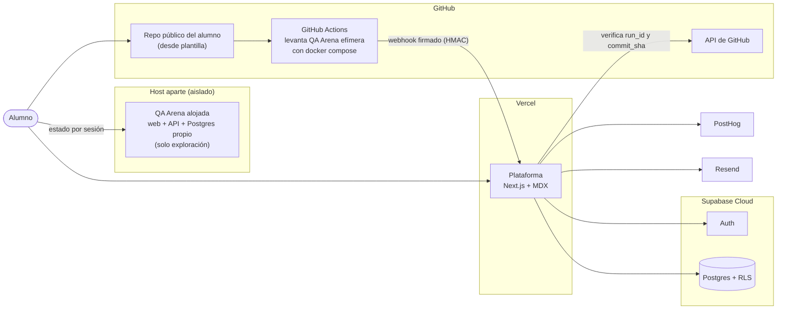
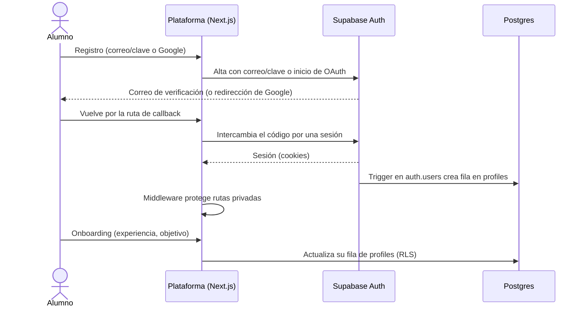
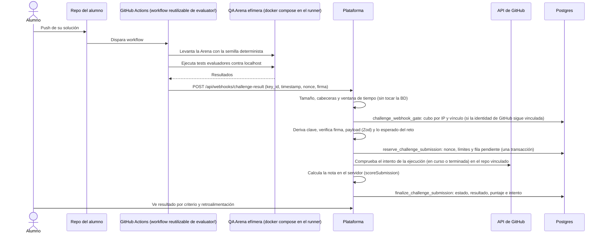
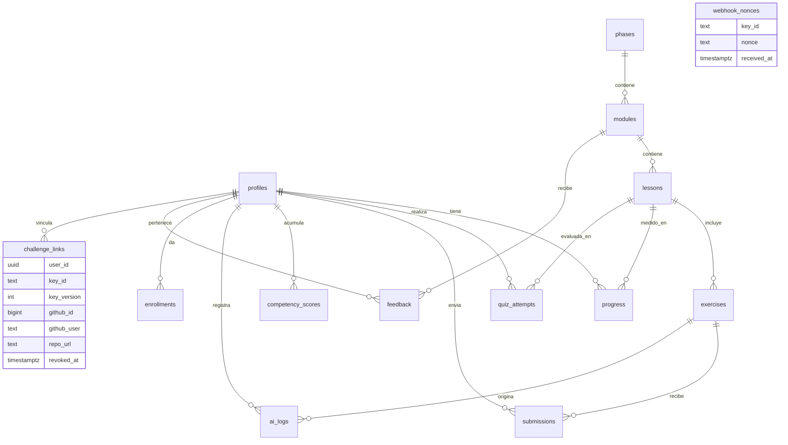

# ARQUITECTURA

Consistente con `PLAN_DESARROLLO.md` (secciones 1, 2, 7, 10, E1-A2, E3-A1, E3-A3 y Anexo B). Es el punto de partida; se ajusta en E1-A2 (esquema y RLS) y E3-A1 (evaluación).

## 1. Componentes

Principios:

- **QA Arena está aislada**: otro proyecto, dominio y base de datos; sin credenciales reales ni compartidas con la plataforma. Contiene defectos intencionales (incluidos de seguridad, módulo 3.6). No hay flecha Arena → Plataforma: la Arena no conoce la plataforma.
- **La plataforma nunca ejecuta código del alumno.** Solo recibe resultados firmados por webhook.
- **Los tests evaluadores no corren contra la Arena alojada.** Cada evaluación levanta una Arena efímera con la semilla determinista dentro del runner del alumno, así que no hay estado compartido entre alumnos. La Arena alojada es solo para explorar (botón `<AbrirArena>`) y guarda el escenario **por sesión**, sin reinicio global.
- **No hay pasarela ni tablas de pagos.** Los aportes son externos (QR con imágenes estáticas).
- El contenido vive en `content/` (MDX) y se sincroniza a la base con un seed idempotente (E2-A1).
- Analítica sin datos personales: solo el id interno de usuario, nunca el correo.
- Secretos solo en el servidor; en el cliente únicamente variables prefijadas como públicas. La clave `service_role` de Supabase nunca llega al navegador.

## 2. Flujo de autenticación

Rutas privadas se protegen en middleware; los datos, con RLS en Postgres (defensa en profundidad). Crear `profiles` con un trigger evita depender de que el cliente complete el alta. Recuperación de clave y cierre de sesión siguen el mismo patrón (E1-A3).

## 3. Flujo de evaluación de retos

### 3.1 Vinculación y secreto por alumno (E3-A2)

El secreto HMAC **no puede ser uno global** dentro de la plantilla: cada alumno lo vería y podría firmar como cualquier otro. Diseño propuesto:

1. El alumno vincula su cuenta de GitHub a su usuario existente (`linkIdentity`; GitHub **solo vincula**, un hook `before_user_created` rechaza las altas nuevas con GitHub, así que no hay botón de GitHub en el login) y registra la URL de su repo, que debe ser **público**. La plataforma crea una fila en `challenge_links` (solo la escribe el servidor), **un vínculo activo por alumno y reto**. El evaluador vive en un repo público aparte (`eduardolulichac/qa-course-evaluator`, publicado desde `evaluator/`).
2. La plataforma genera para ese vínculo un `key_id` público y aleatorio y una **clave por alumno** derivada en el servidor: `clave = HMAC-SHA256(SECRETO_MAESTRO, "course-challenge-key/v1|" + key_id + "|" + key_version)`. El secreto maestro solo existe en las variables de entorno de la plataforma; la clave derivada no se guarda en la base (se recalcula).
3. Se muestra una sola vez la clave y el `key_id`; el alumno los guarda como secretos de GitHub Actions de **su** repo. La plantilla solo referencia los nombres de los secretos, nunca su valor.
4. Rotar o revocar = incrementar `key_version` o marcar el vínculo como revocado. Una clave filtrada solo afecta a ese alumno.

### 3.2 Envío y verificación (E3-A3)

Controles del webhook:

- **Cabeceras**: `key_id`, `timestamp` (Unix, segundos), `nonce` (aleatorio, al menos 128 bits) y `firma`.
- **Qué cubre la firma**: HMAC-SHA256 con la clave del alumno sobre `timestamp + "." + nonce + "." + cuerpo_crudo`. Se verifica sobre el cuerpo crudo (antes de parsear) y con comparación en tiempo constante. Así no se puede reutilizar una firma cambiando timestamp, nonce o contenido.
- **Anti-replay**: rechazo si `|ahora - timestamp|` supera la ventana (propuesta: 5 minutos). El nonce se inserta en `webhook_nonces` con clave única `(key_id, nonce)`; si ya existe, se rechaza. Los nonces más antiguos que la ventana se pueden purgar.
- **Identificación del alumno**: el `user_id` sale **solo** del vínculo asociado a `key_id` (que la firma prueba). Nunca se confía en `user_id` ni `github_user` del payload. `repo_url` del payload debe coincidir con el repo vinculado; `exercise_id` debe existir y ser de tipo reto.
- **Verificación de la ejecución**: el payload incluye `run_id`, `run.attempt` y `commit_sha`; la plataforma consulta `GET /repos/{owner}/{repo}/actions/runs/{run_id}/attempts/{n}` y exige que la ejecución, **en curso o terminada** (el webhook sale desde la propia ejecución, que aún no ha terminado), exista en el repo vinculado, no venga de un fork, tenga ese commit y evento, sea reciente (≤ 2 h) y haya usado el evaluador público (`referenced_workflows`) con un SHA permitido. No prueba que los tests dieran ese resultado, pero impide inventar ejecuciones. Se usa un token de solo lectura de la plataforma por los límites de tasa (`GITHUB_API_TOKEN`). Detalle y campos verificados: `EVALUACION_DISENO.md` §4.5 y `EVALUACION_VERIFICACIONES.md`.
- **Orden de las comprobaciones** (de barato a caro, `EVALUACION_DISENO.md` §4.4): memoria (método, tipo, tamaño, cabeceras, ventana) → gate en BD (cubo por IP, 30/min) → firma → payload y lo esperado del reto → reserva en BD (nonce, cubo por `key_id`, 10/h, fila pendiente única por `(run_id, run_attempt)`) → GitHub → nota → finalización. La ruta queda fuera del `matcher` de `proxy.ts`.
- **Límite de intentos**: por alumno y reto (10 por hora, contando filas de `submissions`) y por IP/`key_id` (30/min) para frenar abuso. Respuesta 429 al exceder. El conteo es atómico (`pg_advisory_xact_lock` por alumno y reto, o un `insert … select … where (select count(*) …) < N` dentro de una función): el patrón «contar y luego insertar» del quiz se superó por 1–2 filas con envíos simultáneos (revisión E2, H30) y aquí protege las llamadas a la API de GitHub.
- **Respuestas**: errores genéricos (401/400/429) sin revelar qué control falló; el detalle va a los logs del servidor.
- Tests obligatorios (E3-A3): firma inválida, nonce repetido, timestamp expirado, `key_id` revocado, repo no coincidente, `run_id` inexistente o con otro commit, límite excedido.

## 4. Modelo de datos

Las 14 tablas de la sección 7 del plan (las 13 originales más `challenge_links`). No hay tablas de pagos.

`challenge_links` guarda el vínculo alumno ↔ repo (un vínculo activo por alumno y reto, y por repo) con `key_id`, `key_version` y estado de revocación; `github_id` y `github_user` viven aquí y salen de `profiles`. `webhook_nonces` tiene clave única `(key_id, nonce)` y `webhook_rate_buckets` (16.ª tabla) lleva los contadores por ventana (IP, `key_id`, presupuesto global de GitHub). Detalle de campos: `PLAN_DESARROLLO.md` sección 7.

### 4.1 RLS por tipo de tabla

RLS activado en **todas** las tablas. La `service_role` de Supabase omite RLS, por eso solo se usa en código de servidor.

| Tipo                  | Tablas                                                                                | `authenticated`                                    | Escritura                                                                                            |
| --------------------- | ------------------------------------------------------------------------------------- | -------------------------------------------------- | ---------------------------------------------------------------------------------------------------- |
| Contenido             | `phases`, `modules`, `lessons`, `exercises`                                           | Solo lectura                                       | Solo service role (seed)                                                                             |
| Propias del alumno    | `profiles`, `progress`, `ai_logs`, `feedback`                                         | Leer y escribir sus filas (`user_id = auth.uid()`) | El alumno (alta de `profiles` por trigger)                                                           |
| Propias, solo lectura | `submissions`, `quiz_attempts`, `competency_scores`, `enrollments`, `challenge_links` | Leer sus filas                                     | Solo service role (webhook, corrección de quizzes, recálculo de nivel, alta en cohorte, vinculación) |
| Internas              | `webhook_nonces`, `webhook_rate_buckets`                                              | Sin acceso (RLS activo y sin políticas)            | Solo service role (webhook)                                                                          |

`nivel_actual` de `profiles` no debe ser editable por el alumno: proteger con permisos por columna o moverlo a una tabla escrita solo por el servidor (por ejemplo derivarlo de `competency_scores`). `github_user` ya no está en `profiles`: vive en `challenge_links`, que el alumno no puede escribir. Test obligatorio (E1-A2): un usuario no lee ni escribe filas de otro.

## 5. Despliegue

| Pieza       | Destino                                                                                              |
| ----------- | ---------------------------------------------------------------------------------------------------- |
| Plataforma  | Vercel                                                                                               |
| Base y auth | Supabase Cloud                                                                                       |
| QA Arena    | Host aparte (Fly.io o Railway) para exploración; Docker Compose en local y en el runner para evaluar |
| CI/CD       | GitHub Actions                                                                                       |

### 5.1 QA Arena: variables y modos de despliegue

La API de la Arena (`apps/qa-arena/api`) valida su entorno al arrancar (`src/config.ts`). Con `NODE_ENV=production`, `ARENA_DEPLOYMENT` y `ARENA_SESSION_MODE` son obligatorias, para que un despliegue olvidado no comparta una sola sesión sin avisar.

| Variable                                | Valor por defecto | Para qué sirve                                                                                                                                                                                                                                                                                |
| --------------------------------------- | ----------------- | --------------------------------------------------------------------------------------------------------------------------------------------------------------------------------------------------------------------------------------------------------------------------------------------- |
| `ARENA_DEPLOYMENT`                      | `local`           | `local` (desarrollo), `ephemeral` (la Arena del runner, un solo alumno) o `hosted` (la alojada para explorar)                                                                                                                                                                                 |
| `ARENA_SESSION_MODE`                    | `shared`          | `shared` (una sesión) o `per-visitor` (cookie por visitante); `hosted` exige `per-visitor`                                                                                                                                                                                                    |
| `ARENA_COOKIE_SECRET`                   | —                 | Firma de la cookie de sesión (mínimo 32 caracteres); obligatoria con `hosted`                                                                                                                                                                                                                 |
| `ARENA_MAX_SESSIONS` / `_PER_IP`        | 500 / 3           | Tope total (`503 arena_full`, no se expulsa a nadie) y cuota por IP (expulsa solo la sesión más antigua de esa IP)                                                                                                                                                                            |
| `ARENA_SESSION_TTL_MINUTES`             | 240               | Las sesiones inactivas se purgan pasado este tiempo                                                                                                                                                                                                                                           |
| `ARENA_RATE_LIMIT_PER_MIN`              | 120               | Límite por IP; solo se aplica en `hosted` (`/__arena/scenario` y `/__arena/reset`: 10 por minuto)                                                                                                                                                                                             |
| `ARENA_TRUST_PROXY`                     | `0`               | Número de saltos de proxy de confianza para `req.ip` (0 = ninguno). **Nunca `true`**: confiaría en todo `X-Forwarded-For`, que controla el cliente (H20). Detrás de un solo proxy del host, 1; verificar en la documentación de Fly o Railway cuántos saltos añaden antes de activar `hosted` |
| `ARENA_DEFAULT_SCENARIO`                | `baseline`        | Escenario con el que nace cada sesión nueva; se valida contra el registro al arrancar                                                                                                                                                                                                         |
| `ASSISTANT_API_KEY` / `ASSISTANT_MODEL` | —                 | Asistente con LLM real (opcional; sin ellas responde el stub determinista)                                                                                                                                                                                                                    |

Diferencias por modo:

- **`hosted`**: se ignora la cabecera `X-Arena-Session` (solo vale la cookie firmada, `Secure`); no se activan los escenarios `runnerOnly`; una lectura anónima se sirve desde un esquema plantilla de solo lectura y no crea sesión (la primera escritura la crea).
- **`ephemeral`**: levantada por el workflow dentro del runner; admite `X-Arena-Session` para aislar workers paralelos y es el único modo que activa defectos `runnerOnly`.
- **`local`**: la de `docker compose up` del alumno; sin límite de peticiones ni cuota.

La API se conecta a Postgres con el rol `arena_app` (sin superusuario, creado por `apps/qa-arena/db/init/01-app-role.sh`; solo en volúmenes nuevos: tras cambiarlo, `docker compose down -v`). La imagen compila el motor (`packages/scenario-engine`) y los escenarios (`apps/qa-arena/scenarios`) y la API carga su `dist`.

Base de solo lectura para el alumno (módulo 2.5), fuera de la API: el compose de la Arena crea el rol `arena_qa` con `db/init/02-qa-reader.sh`, que lee la contraseña de `ARENA_QA_PASSWORD` (en local, `arena_qa_local_only`; en el runner, `arena_qa_eval_only`; ambas públicas). En la Arena local, `DB_PORT` (por defecto `15432`) se publica solo en `127.0.0.1`. La Arena alojada y la del evaluador no publican la base. Diseño: [`docs/E4_F2_DISENO.md`](E4_F2_DISENO.md) §2.4.

## 6. Decisiones y riesgos

### 6.1 Decisiones tomadas (2026-11-05)

- **Vínculo alumno↔repo**: tabla `challenge_links` (user_id, key_id, key_version, github_user, repo_url, revoked_at), escrita solo por service role. `github_user` sale de `profiles`. Motivo: `profiles` es editable por el alumno desde el cliente; separar el vínculo evita proteger columnas una a una y soporta un repo por reto y la rotación de claves.
- **QA Arena y concurrencia**: la evaluación levanta la Arena con Docker Compose dentro del runner (semilla determinista, sin estado compartido). La Arena alojada es solo para explorar, con el escenario guardado por sesión y sin reinicio global. Motivo: los escenarios inyectan fallos y latencia; en una instancia compartida un alumno afectaría a los demás.
- **Integridad de resultados**: se acepta el riesgo en el piloto (gratuito, 25–30 alumnos, sin certificación) con dos mitigaciones: workflow reutilizable fijado desde `evaluator/` y verificación de `run_id` y `commit_sha` contra la API de GitHub. Consecuencia: los repos de los alumnos deben ser públicos. Mejora posterior al piloto: OIDC de GitHub, que además elimina el secreto por alumno (verificar los claims en la documentación oficial antes de diseñar).
- **Verificación de `github_user`**: OAuth de GitHub (identidad vinculada a la cuenta de Supabase). Se guarda el `github_id` numérico (el login puede cambiar) además de `github_user`, y el propietario del repo debe coincidir con ese `github_id`. Alcance mínimo: solo identificar al usuario, sin acceso a sus repos (son públicos). El campo manual no prueba propiedad. Verificar en la documentación oficial de Supabase cómo vincular la identidad antes de E3-A2.
- **Cuestionarios**: la nota se calcula en el servidor (Server Action o ruta de API). Las respuestas correctas no viajan al cliente; la explicación se devuelve tras enviar. `quiz_attempts` pasa a ser de solo lectura para el alumno y la escribe el servidor.
- **Panel del autor (E6-2)**: solo lectura, renderizado en servidor con `service_role` y limitado por una lista de ids de autor en variable de entorno (`AUTHOR_USER_IDS`). Sin rol de administrador en la base durante el piloto.
- **Valores iniciales del webhook** (a confirmar con pruebas en E3-A3): ventana anti-replay de 5 minutos; 10 envíos por hora por alumno y reto; antes de verificar, 30 solicitudes por minuto por `key_id` y por IP. Respuesta 429 al exceder.

### 6.2 Abiertas

- ~~Endpoints y campos de la API de GitHub~~ y ~~vinculación de identidad con Supabase~~: verificados (tarea V, `EVALUACION_VERIFICACIONES.md`) e implementados en E3-A2/E3-A3. Quedan los experimentos X1 y X2 (E3-A4) y X5 (E5-1).
