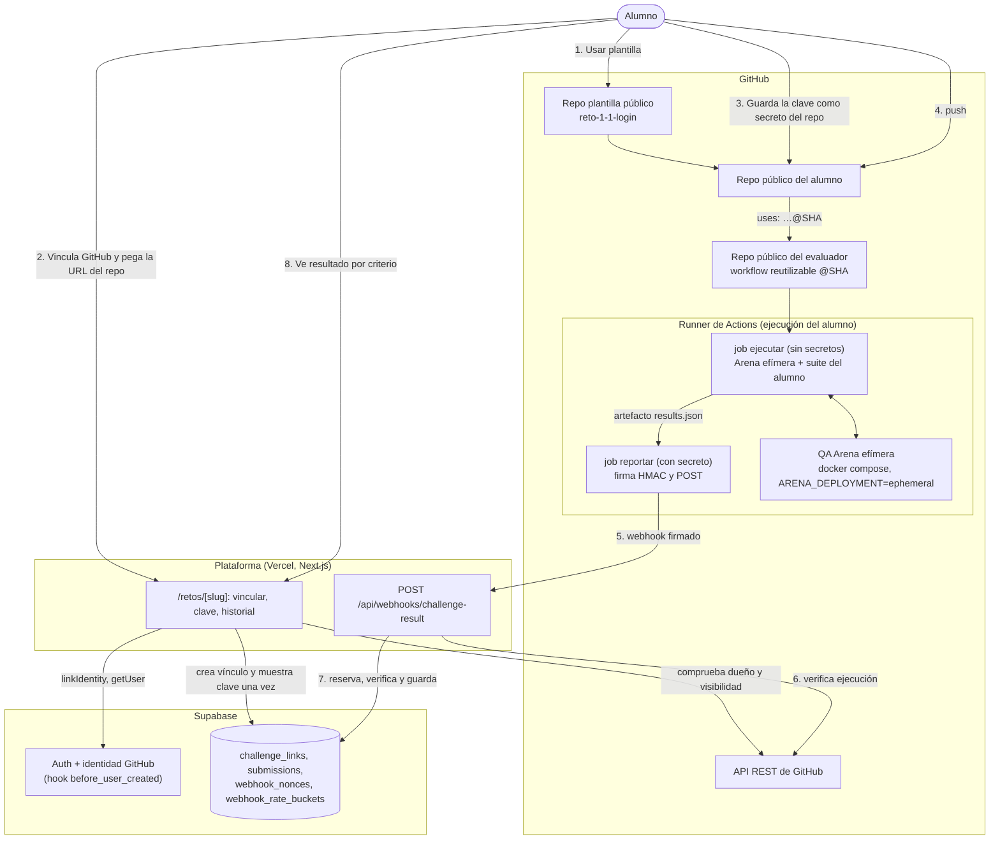
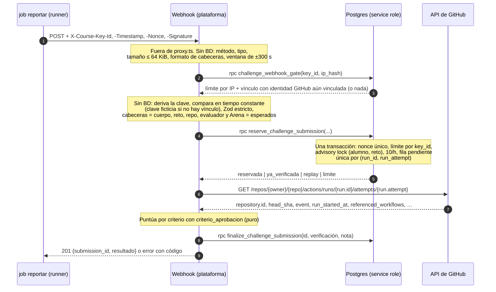
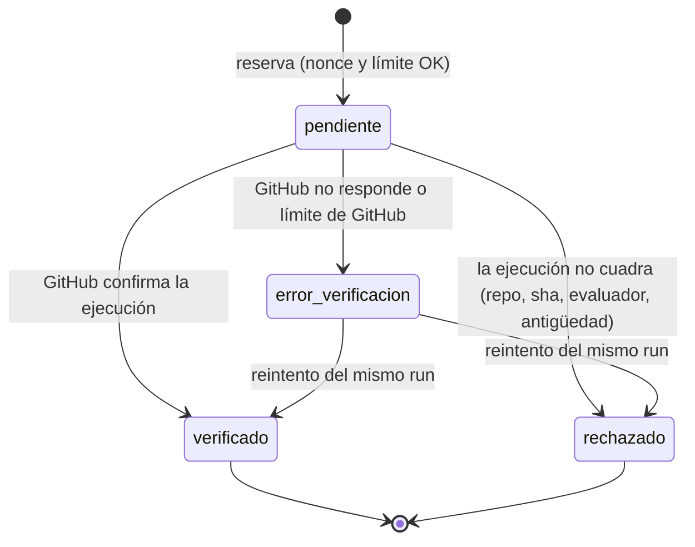

# Evaluación de retos: diseño (E3-A1)

Estado: diseño revisado (Opus, 2026-11-06) con las decisiones P1–P3 del autor y los cambios C1–C17 de la verificación (`docs/EVALUACION_VERIFICACIONES.md`). Parte de `docs/ARQUITECTURA.md` §3 y §6 y de `docs/scenario-engine-design.md`, y los concreta. Lo que aquí se decide manda sobre `ARQUITECTURA.md` §3 en lo que toque al webhook. La tarea E3-A3 actualiza ese documento (ver §9.6). Incorpora H15, H21, H25, H26, H27, H30 y H35 de las revisiones de E1, E2-B1 y E2.

La tarea V (regla 5 del plan) ya respondió las preguntas sobre GitHub, Supabase, Vercel y Next.js; sus fuentes están en `docs/EVALUACION_VERIFICACIONES.md`. Lo que ninguna fuente oficial confirma y solo se puede comprobar creando recursos queda marcado **«pendiente de X1…X5»**: son cinco experimentos mínimos repartidos entre E3-A2, E3-A3, E3-A4 y E5-1, cada uno con su criterio de aceptación y su alternativa si falla (§10.2). Lo poco que queda **«por verificar»** fuera de esos experimentos es un detalle de implementación que comprueba la propia tarea.

## 0. Decisiones en una línea

1. **Un vínculo por alumno y reto.** `challenge_links` gana `exercise_id` y `repo_id` (id numérico de GitHub). Cada vínculo tiene su `key_id` y su clave. Rotar o revocar afecta a un solo reto de un solo alumno.
2. **La clave se deriva y no se guarda**: `HMAC-SHA256(CHALLENGE_MASTER_SECRET, "course-challenge-key/v1|" + key_id + "|" + key_version)`. Se muestra una sola vez y el alumno la guarda como **secreto de Actions** de su repo. La plantilla solo nombra el secreto.
3. **Firma v1**: `HMAC-SHA256(clave, "v1." + timestamp + "." + nonce + "." + cuerpo_crudo)`, en hexadecimal, en la cabecera `X-Course-Signature: v1=<hex>`. Se firma el cuerpo crudo, así que no hace falta canonicalizar el JSON.
4. **La plataforma no se fía de la nota enviada.** El payload trae el estado de cada criterio (`pass`/`fail`/`error`). La puntuación, el aprobado y la competencia los calcula el servidor con el `criterio_aprobacion` de la BD.
5. **El evaluador es un workflow reutilizable en un repo público aparte** (`eduardolulichac/qa-course-evaluator`, publicado desde `evaluator/`), fijado por SHA en la plantilla. Es obligatorio: un repo público solo puede llamar a workflows de repos públicos. La plataforma exige que la ejecución lo haya usado (`referenced_workflows` del intento en la API de GitHub) con un SHA de una lista permitida.
6. **La ejecución se acepta en curso.** El webhook sale desde un paso de la propia ejecución, que aún no ha terminado cuando llega. Se consulta el **intento concreto** (`…/runs/{id}/attempts/{n}`) y se exige que exista, que sea del repo vinculado, que tenga ese `head_sha`, que sea reciente y que no venga de un fork. `ARQUITECTURA.md` §3 dice «ya finalizada»: lo corrige E3-A3 (§9.6).
7. **El workflow tiene dos jobs**: `ejecutar` (Arena efímera y suite del alumno, **sin secretos**) y `reportar` (firma y envía, no ejecuta código del alumno).
8. **Comprobaciones de barato a caro**, con tres idas a la BD como máximo y la llamada a GitHub solo después de verificar la firma y de reservar el intento bajo un límite **atómico** (H30).
9. **Idempotencia por ejecución**: `unique (run_id, run_attempt)` en `submissions`. Un reintento del mismo envío no duplica: reverifica la fila pendiente o devuelve la ya registrada.
10. **El nivel (E3-C1) usa el primer intento aprobado**, con un factor por número de intentos. No usa la mejor nota (H35). Un reto aprobado queda congelado para el nivel.
11. **GitHub solo se vincula, no sirve para darse de alta.** Vincular exige habilitar el proveedor GitHub en Supabase. Un hook `before_user_created` rechaza las cuentas nuevas con `provider = 'github'`. No hay botón de GitHub en el login (P3, opción A; pendiente de X3).

## 1. Resumen, alcance y no-objetivos

### 1.1 Resumen

El alumno crea un repo **público** desde la plantilla del reto, vincula su cuenta de GitHub y el repo en la plataforma, y guarda la clave del vínculo como secreto del repo. En cada `push` a `main`, o a mano con `workflow_dispatch`, el workflow de la plantilla llama al workflow reutilizable del evaluador. Este levanta la QA Arena efímera con Docker Compose en el runner, con escenario y semilla fijos por reto. Después ejecuta la suite del alumno en varias fases, aplica los criterios, firma el resultado y lo envía a `POST /api/webhooks/challenge-result`. La plataforma valida la firma, identifica al alumno **solo** por el `key_id`, comprueba la ejecución contra la API de GitHub, aplica los límites y guarda la entrega en `submissions`. La plataforma nunca ejecuta código del alumno.

### 1.2 Alcance

- Contrato del payload y de la firma, y orden de las comprobaciones del webhook (E3-A3).
- Vinculación alumno ↔ GitHub ↔ repo y ciclo de vida de la clave (E3-A2).
- Workflow reutilizable, Arena efímera determinista y primera plantilla, `reto-1-1-login` (E3-A4).
- Forma de `criterio_aprobacion` y cálculo de la nota por criterio y por competencia (base de E3-C1).
- Esquema de BD, RLS y qué ve el alumno (E3-A5).

### 1.3 No-objetivos del piloto (riesgos aceptados de forma explícita)

- **La firma no prueba que los tests se ejecutaran ni que dieran ese resultado.** El alumno controla su repo y su secreto, así que puede firmar lo que quiera. Mitigaciones acordadas (2026-11-05): workflow reutilizable fijado por SHA y verificación de `run_id`/`commit_sha` (más `referenced_workflows`) contra la API de GitHub. Con eso es más difícil inventar resultados, no imposible: dentro de una ejecución real que use el evaluador, el alumno puede añadir otro job que firme otra cosa. Se acepta porque el curso es gratuito, de 25 a 30 alumnos y sin certificación.
- **Los repos de los alumnos son públicos.** Copiar una solución es posible. No se detecta plagio en el piloto.
- **No hay OIDC de GitHub en el piloto.** Tras el piloto, un token OIDC emitido para el job del evaluador sustituiría la clave por alumno y ataría la firma al workflow del evaluador. Es la mejora estructural pendiente. Confirmado: el token trae `job_workflow_ref`, `job_workflow_sha`, `repository_id`, `repository_owner_id`, `run_id` y `run_attempt`. Como el evaluador es de otra cuenta, la plantilla tendrá que dar `permissions: id-token: write` de forma explícita en el job `evaluar`, y la plataforma comprobará `job_workflow_sha` contra `EVALUATOR_ALLOWED`.
- No hay revisión manual de cada entrega ni evaluación de calidad del código más allá de los criterios estáticos declarados.
- No hay runners propios: se usan los runners estándar alojados por GitHub, gratuitos en repos públicos (confirmado).

## 2. Diagramas

### 2.1 Extremo a extremo



### 2.2 Secuencia del webhook



### 2.3 Estados de una entrega



Solo las filas `verificado` tienen `resultado` (`aprobado`, `reprobado` o `error`) y cuentan para el nivel. Todas, en cualquier estado, cuentan para el límite de 10 por hora.

## 3. Modelo de amenazas

Actores: alumno tramposo (tiene su clave y controla su repo), tercero sin clave (conoce el endpoint y quizá algún `key_id`), y dependencia maliciosa en el `node_modules` del alumno.

| #   | Amenaza                                                                                           | Defensa                                                                                                                                                                                                                                                                                                                                                                                                                        | Residual                                                                                                                                                            |
| --- | ------------------------------------------------------------------------------------------------- | ------------------------------------------------------------------------------------------------------------------------------------------------------------------------------------------------------------------------------------------------------------------------------------------------------------------------------------------------------------------------------------------------------------------------------ | ------------------------------------------------------------------------------------------------------------------------------------------------------------------- |
| T1  | El alumno forja resultados sin ejecutar nada (curl con su clave)                                  | `run_id` debe existir en su repo vinculado, con ese `head_sha`, evento `push`/`workflow_dispatch`, reciente, no desde un fork y con el evaluador en `referenced_workflows` a un SHA permitido. Un `run_id` solo se usa una vez por intento                                                                                                                                                                                     | **Aceptado**: puede firmar otro resultado dentro de una ejecución real (job propio, o editando `results.json` en `ejecutar`)                                        |
| T2  | La suite del alumno detecta el escenario y falla a propósito (`if escenario != baseline fail`)    | Criterio estático obligatorio `sin-arena-interna`: la suite no puede referenciar `/__arena`, `X-Arena-*` ni `ARENA_*`. El evaluador activa el escenario por API antes de cada fase                                                                                                                                                                                                                                             | **Aceptado**: se puede ocultar mejor (ofuscación). Revisión puntual del autor. Con el token de runner (§6.5) la ofuscación ya no obtiene la identidad del escenario |
| T3  | Repetición de un envío capturado (logs, proxy)                                                    | Ventana de ±300 s; nonce único por `key_id` en `webhook_nonces`; la firma cubre timestamp, nonce y cuerpo                                                                                                                                                                                                                                                                                                                      | —                                                                                                                                                                   |
| T4  | Repo o ejecución ajenos (usar el `run_id` de otro alumno, vincular el repo de otro)               | Al vincular: `owner.id` del repo = `github_id` de la identidad OAuth del alumno (leída con `auth.getUser()` en el servidor). En el webhook: la identidad GitHub sigue vinculada a ese alumno (gate), `repository.id` de la ejecución = `repo_id` del vínculo y `repository.owner.id` = `github_id`. Se compara por id numérico, no por nombre (un login antiguo queda libre para otro usuario)                                 | —                                                                                                                                                                   |
| T5  | Suplantar a otro alumno                                                                           | `user_id` sale solo del vínculo del `key_id`, nunca del payload. Clave distinta por vínculo                                                                                                                                                                                                                                                                                                                                    | —                                                                                                                                                                   |
| T6  | Fuerza bruta de clave o enumeración de `key_id`                                                   | Clave de 256 bits. `key_id` aleatorio de 128 bits. Respuesta 401 genérica e idéntica si el `key_id` no existe, está revocado o la firma falla; HMAC con clave ficticia para no dar un oráculo de tiempo. 30/min por IP antes de verificar                                                                                                                                                                                      | —                                                                                                                                                                   |
| T7  | Filtración de la clave en el repo público (el alumno la escribe en un archivo o en un log)        | La clave vive en secretos de Actions, nunca en la plantilla. El job `reportar` busca la clave en el árbol del commit (`git grep -F`) y, si aparece, no envía y avisa. Botón «Rotar clave» en la plataforma (sube `key_version`). `reportar` nunca imprime la clave ni transformaciones suyas (base64, hex). El enmascarado de GitHub es solo una ayuda: «no está garantizado» y solo actúa en el job que usa el secreto        | Quien la copie solo puede afectar a ese alumno y ese reto, y aun así necesita un `run_id` válido de su repo                                                         |
| T8  | Aprovechar secretos del workflow (PR desde un fork, `pull_request_target`, dependencia maliciosa) | La plantilla solo dispara con `push` a `main` y `workflow_dispatch`. Nunca `pull_request_target`. `permissions: contents: read`. La suite del alumno corre en `ejecutar`, que no recibe el secreto. La verificación exige `head_repository.id = repository.id`. Confirmado: los workflows no corren en forks por defecto y GitHub no pasa secretos (salvo `GITHUB_TOKEN` de solo lectura) a ejecuciones lanzadas desde un fork | El alumno siempre puede leer su propio secreto: es suyo                                                                                                             |
| T9  | Abuso de la API de GitHub a través del webhook (agotar el cupo del token de la plataforma)        | GitHub solo se llama tras firma válida, nonce nuevo y reserva bajo el límite atómico de 10/h por alumno y reto y 30/min por `key_id`. Tope global `github:global` (por defecto 1000/h) en `webhook_rate_buckets`. Timeout de 5 s. Ante 403/429 de GitHub: `error_verificacion` y 503 con `Retry-After` tomado de `retry-after` o `x-ratelimit-reset` de GitHub                                                                 | Un alumno puede gastar hasta 10 llamadas por hora y reto                                                                                                            |
| T10 | Filtración de `CHALLENGE_MASTER_SECRET`                                                           | Solo en variables de entorno del servidor (Vercel), nunca en el cliente ni en la BD. Su rotación invalida todas las claves                                                                                                                                                                                                                                                                                                     | **Aceptado**: rotar el secreto maestro obliga a todos a volver a copiar la clave (§4.8)                                                                             |
| T11 | Payload enorme o malicioso (DoS, inyección en `detalle_json`)                                     | Límite de 64 KiB leído en crudo antes de parsear; Zod estricto con longitudes máximas; la evidencia se guarda como texto y se renderiza escapada (sin MDX ni HTML)                                                                                                                                                                                                                                                             | —                                                                                                                                                                   |
| T12 | Envíos concurrentes para saltarse el límite (H30)                                                 | Reserva en una función SQL con `pg_advisory_xact_lock` por (alumno, reto) y contadores con `insert … on conflict do update … returning` (§7)                                                                                                                                                                                                                                                                                   | —                                                                                                                                                                   |
| T13 | El alumno edita los tests evaluadores o el workflow                                               | El evaluador vive en otro repo y se fija por SHA. La plataforma comprueba en GitHub que la ejecución usó ese workflow a un SHA permitido y que el payload declara la misma versión                                                                                                                                                                                                                                             | Ver T1                                                                                                                                                              |
| T14 | Darse de alta solo con GitHub (saltándose Google) al quedar habilitado el proveedor para vincular | Hook `before_user_created` que rechaza (403) toda cuenta nueva con `app_metadata.provider = 'github'`. Sin botón de GitHub en el login. Vincular no crea usuario, así que el hook no la bloquea (pendiente de X3)                                                                                                                                                                                                              | Quien ya vinculó GitHub puede iniciar sesión con GitHub (aceptado en P3)                                                                                            |
| T15 | Desvincular GitHub desde el navegador (`unlinkIdentity()`) sin pasar por la Server Action         | `challenge_webhook_gate` solo devuelve el vínculo si la identidad GitHub (`provider_id = github_id`) sigue vinculada al mismo `user_id`. Al crear un vínculo, uno activo de otro alumno con la identidad ya desvinculada se revoca                                                                                                                                                                                             | —                                                                                                                                                                   |

## 4. Contrato del payload y de la firma

El contrato vive en `packages/shared/src/challenge-result.ts` (Zod más funciones puras), y lo importan la plataforma y el evaluador. Así no hay dos definiciones.

### 4.1 Cabeceras

| Cabecera             | Formato                                         | Notas                                                                |
| -------------------- | ----------------------------------------------- | -------------------------------------------------------------------- |
| `Content-Type`       | `application/json`                              | Otro valor → 415                                                     |
| `X-Course-Key-Id`    | `^ck_[A-Za-z0-9_-]{22}$` (16 bytes base64url)   | Público. No es secreto, pero tampoco se publica                      |
| `X-Course-Timestamp` | Unix en segundos, entero decimal `^\d{10}$`     | Ventana ±300 s respecto al reloj del servidor                        |
| `X-Course-Nonce`     | `^[A-Za-z0-9_-]{22,64}$` (≥ 16 bytes base64url) | Aleatorio por envío (también por reintento)                          |
| `X-Course-Signature` | `^v1=[0-9a-f]{64}$`                             | Versión del esquema de firma más el HMAC en hexadecimal (minúsculas) |

### 4.2 Firma

```
clave           = HMAC-SHA256(CHALLENGE_MASTER_SECRET, "course-challenge-key/v1|" + key_id + "|" + key_version)
                  (32 bytes; al alumno se le muestra como "cck_" + base64url(clave))
cadena_firmada  = "v1." + X-Course-Timestamp + "." + X-Course-Nonce + "." + cuerpo_crudo
firma           = hex(HMAC-SHA256(clave, cadena_firmada))
```

- **Canonicalización**: ninguna sobre el JSON. Se firma y se verifica sobre los bytes exactos del cuerpo (UTF-8), leídos en crudo antes de parsear. El emisor serializa una vez y envía esos mismos bytes. Timestamp y nonce se usan tal como llegan en la cabecera, sin reformatear.
- **Comparación** en tiempo constante (`crypto.timingSafeEqual` sobre los dos buffers de 32 bytes, tras validar la longitud con la regex).
- `"v1."` separa versiones: un `v2` (por ejemplo con OIDC) no podrá confundirse con `v1`.
- La clave que ve el alumno es `cck_` + base64url de los 32 bytes. El evaluador quita el prefijo y decodifica. El prefijo hace reconocible una clave filtrada.
- `CHALLENGE_MASTER_SECRET`: al menos 32 bytes aleatorios; la plataforma lo valida al arrancar.

### 4.3 Cuerpo (`challenge-result/v1`)

```json
{
  "schema": "challenge-result/v1",
  "key_id": "ck_3q2-7wEXAMPLE0000000a",
  "timestamp": 1793980800,
  "nonce": "pX0v6l2nRk5a7wq1Zb9cYg",
  "exercise": "reto-1-1-login",
  "repo": { "id": 912345678, "full_name": "alumna/reto-1-1-login" },
  "run": {
    "id": 18234567890,
    "attempt": 1,
    "commit_sha": "4f1c0e5b9a7d3c2e1f0a9b8c7d6e5f4a3b2c1d0e",
    "event": "push"
  },
  "evaluator": { "version": "1.0.0", "sha": "a1b2c3d4e5f60718293a4b5c6d7e8f9012345678" },
  "arena": {
    "image_digest": "sha256:…",
    "seed_version": "arena-seed-2",
    "scenario": "fase1-login",
    "release": null,
    "rng_seed": 1046
  },
  "criteria": [
    { "id": "suite-ejecuta", "status": "pass", "evidence": "4 tests encontrados" },
    { "id": "suite-verde-baseline", "status": "pass", "evidence": "4/4 pasan en baseline" },
    {
      "id": "detecta-fase1-login",
      "status": "fail",
      "evidence": "0/4 fallan con fase1-login: la suite no detecta el defecto"
    }
  ],
  "summary": { "duration_ms": 81234, "tests_total": 4 }
}
```

| Campo                          | Regla Zod (todo `strictObject`)                                                                     | Comprobación posterior                                                                           |
| ------------------------------ | --------------------------------------------------------------------------------------------------- | ------------------------------------------------------------------------------------------------ |
| `schema`                       | literal `challenge-result/v1`                                                                       | —                                                                                                |
| `key_id`, `timestamp`, `nonce` | mismos formatos que las cabeceras                                                                   | Iguales a las cabeceras (si no, 400)                                                             |
| `exercise`                     | `SLUG_ID_REGEX`                                                                                     | = slug del ejercicio del vínculo; tipo `reto`; lección publicada                                 |
| `repo.id` / `repo.full_name`   | entero > 0 / `^[A-Za-z0-9-]+/[A-Za-z0-9._-]+$`, ≤ 140                                               | `id` = `challenge_links.repo_id`. El nombre se actualiza si cambió (renombrado)                  |
| `run.id`, `run.attempt`        | entero > 0; entero 1..100                                                                           | Contra GitHub (§4.5)                                                                             |
| `run.commit_sha`               | `^[0-9a-f]{40}$`                                                                                    | = `head_sha` de la ejecución                                                                     |
| `run.event`                    | `push` \| `workflow_dispatch`                                                                       | = `event` de la ejecución                                                                        |
| `evaluator.version` / `.sha`   | semver / 40 hex                                                                                     | Par presente en `EVALUATOR_ALLOWED` (config del servidor) y coherente con `referenced_workflows` |
| `arena.*`                      | digest `^sha256:[0-9a-f]{64}$`; textos ≤ 64; `rng_seed` entero ≥ 0                                  | `scenario`, `release` y `rng_seed` = los de `criterio_aprobacion.arena` del ejercicio            |
| `criteria[]`                   | 1..50 elementos; `id` slug único; `status` `pass` \| `fail` \| `error`; `evidence` ≤ 500 caracteres | Mismo conjunto de ids que `criterio_aprobacion.criterios` (si falta o sobra uno, 422)            |
| `summary`                      | opcional; enteros ≥ 0                                                                               | Solo informativo                                                                                 |

No hay `user_id`, `github_user`, `score` ni `aprobado` en el payload, ni se aceptan: Zod estricto los rechaza.

### 4.4 Orden de las comprobaciones (barato → caro)

| Paso | Dónde                      | Comprobación                                                                                                                                                                                                                                                                    | Fallo (código HTTP · `code`)                                                                                 |
| ---- | -------------------------- | ------------------------------------------------------------------------------------------------------------------------------------------------------------------------------------------------------------------------------------------------------------------------------- | ------------------------------------------------------------------------------------------------------------ |
| 1    | Memoria                    | `POST`; `Content-Type`; `content-length` > 65 536 → 413 sin leer; cuerpo leído en crudo de `request.body` con un contador, cortando al pasar 64 KiB (también sin `content-length`)                                                                                              | 405, 415, 413                                                                                                |
| 2    | Memoria                    | Las cuatro cabeceras presentes y con formato válido                                                                                                                                                                                                                             | 400 `bad_request`                                                                                            |
| 3    | Memoria                    | `abs(ahora − timestamp) ≤ 300`                                                                                                                                                                                                                                                  | 401 `unauthorized`                                                                                           |
| 4    | **BD 1** (una RPC)         | `challenge_webhook_gate(key_id, ip_hash)`: suma 1 al cubo `ip:<hash>` del minuto y devuelve si superó 30, más el vínculo (`user_id`, `key_version`, `revoked_at`, `exercise`, `repo_id`, `github_id`, `criterio_aprobacion`) solo si la identidad GitHub sigue vinculada (§8.2) | 429 `rate_limited` (IP)                                                                                      |
| 5    | Memoria                    | Deriva la clave (o una ficticia si no hay vínculo o está revocado) y compara la firma en tiempo constante. Vínculo ausente, revocado o firma distinta: misma respuesta                                                                                                          | 401 `unauthorized`                                                                                           |
| 6    | Memoria                    | `JSON.parse` + Zod estricto; cabeceras = cuerpo                                                                                                                                                                                                                                 | 400 `invalid_payload`                                                                                        |
| 7    | Memoria                    | Reto, repo, evaluador permitido, tupla de la Arena y conjunto de criterios = los esperados                                                                                                                                                                                      | 422 `exercise_mismatch` · `repo_mismatch` · `evaluator_not_allowed` · `arena_mismatch` · `criteria_mismatch` |
| 8    | **BD 2** (una transacción) | `reserve_challenge_submission`: nonce nuevo; cubo `key:<key_id>` ≤ 30/min; lock (alumno, reto); ≤ 10 en la última hora; fila `pendiente` única por (`run_id`, `run_attempt`)                                                                                                    | 409 `replay`; 429 `rate_limited`; 200 `already_recorded`                                                     |
| 9    | **GitHub** (timeout 5 s)   | Intento de la ejecución (§4.5). Antes, cubo `github:global` (en la misma transacción del paso 8)                                                                                                                                                                                | 422 `run_not_verified`; 503 `verification_unavailable`                                                       |
| 10   | Memoria                    | Puntuación pura (`scoreSubmission`, §6.4)                                                                                                                                                                                                                                       | —                                                                                                            |
| 11   | **BD 3**                   | `finalize_challenge_submission`: estado, `resultado`, `puntaje`, `intento`, detalle                                                                                                                                                                                             | 500 `internal` (se registra; la fila queda `pendiente` y un reintento la retoma)                             |

Notas:

- La ruta queda **fuera del `matcher` de `apps/platform/proxy.ts`** (hoy lo cubre todo salvo estáticos). Con proxy, Next.js clona el cuerpo y lo guarda en memoria (y lo trunca por encima de 10 MB con solo un aviso en el log), y `updateSession` llamaría a Supabase Auth en cada webhook. La ruta corre en runtime `nodejs` (el valor por defecto; se exporta `runtime = "nodejs"` para dejar clara la intención) y firma y verifica sobre los bytes leídos (`Buffer`). Vercel admite hasta 4,5 MB por petición, así que el tope de 64 KiB lo aplica la ruta.
- Hasta el paso 3 no se toca la BD. La única escritura antes de verificar la firma es el contador por IP (una fila por IP y minuto), así que un tercero sin clave no puede llenar `webhook_nonces` ni `submissions`.
- El contador por `key_id` se suma **después** de verificar la firma (paso 8). Si se sumara antes, un tercero que conociera un `key_id` podría bloquear a ese alumno.
- Antes de la firma, todos los errores son genéricos (400/401/429). Después, quien llama ya demostró ser el alumno: se devuelve un `code` estable para que el log del workflow diga qué arreglar. El detalle (qué campo de GitHub no cuadró) solo va al log del servidor.
- `ip_hash` = `sha256(ip + CHALLENGE_MASTER_SECRET)`; no se guarda la IP en claro. `ip = x-vercel-forwarded-for ?? x-real-ip ?? "local"`, tomando el primer valor si llega una lista. Vercel sobrescribe esas cabeceras para evitar que se falseen (`x-forwarded-for` podría cambiar si hubiera otro proxy delante, por eso no se usa). Sin ellas (local o CI con `next start`, donde el cliente controla las cabeceras) se usa el valor fijo `local`. Que el cliente no pueda falsearlas en un despliegue real queda pendiente de X5 (E5-1).
- Respuesta de éxito: `201 {"submission_id": "...", "resultado": "aprobado", "puntaje": 85, "url": "https://…/retos/reto-1-1-login"}`. Con 200 `already_recorded` devuelve lo mismo de la fila existente.
- Todos los errores: `{"error": "<code>"}` y, si aplica, `Retry-After`.

### 4.5 Verificación de la ejecución en GitHub

Endpoint: **`GET /repos/{owner}/{repo}/actions/runs/{run.id}/attempts/{run.attempt}`**, con `{owner}/{repo}` = `repo_full_name` del vínculo. Tiene el mismo esquema que la ejecución: `id`, `head_sha`, `status`, `conclusion`, `event`, `path`, `run_attempt`, `referenced_workflows[]` (`path` y `sha` obligatorios, `ref` opcional), `repository.id`, `repository.owner.id`, `head_repository` (con `id`), `created_at`, `run_started_at` y `actor` (REST «Workflow runs», versión `2022-11-28`). No se usa el endpoint sin `/attempts`: devuelve siempre el **último** intento (observado), así que el webhook de un intento 1 que llegara tarde tras relanzar fallaría sin motivo, y su `created_at` es el del intento 1. Con `/attempts/{n}`, la idempotencia `(run_id, run_attempt)` y la verificación hablan del mismo intento.

Se exige:

1. Respuesta 200. Un 404 (ejecución o intento inexistente) → `run_not_verified`. 403/429 por límite, 5xx o timeout → `error_verificacion` y 503 con `Retry-After` tomado de `retry-after` o, si `x-ratelimit-remaining` es 0, de `x-ratelimit-reset`. Un 301 (repo renombrado o transferido) se sigue (una redirección como máximo); manda la comparación por id del punto 2.
2. `repository.id = challenge_links.repo_id` y `repository.owner.id = challenge_links.github_id`.
3. `head_repository.id = repository.id` (no viene de un fork).
4. `head_sha = run.commit_sha`, `event = run.event` y `event ∈ {push, workflow_dispatch}`.
5. `run_attempt = run.attempt` (comprobación de coherencia: el endpoint ya es el de ese intento).
6. Se acepta **cualquier** `status` (`queued`, `in_progress`, `waiting`, `pending`, `requested`, `completed`…): la ejecución está en curso cuando llega el webhook (observado: 200 con `status: "in_progress"` y `conclusion: null`), y el resto de comprobaciones bastan. El `run_started_at` **de ese intento** debe estar dentro de las últimas 2 h y no ser posterior a `timestamp` (+300 s de tolerancia de reloj). El job del evaluador tiene `timeout-minutes: 30`.
7. `referenced_workflows` contiene una entrada con `path == EVALUATOR_REPO + "/" + EVALUATOR_WORKFLOW_PATH + "@" + sha` y `sha == evaluator.sha`, con el par `version@sha` en `EVALUATOR_ALLOWED`. El `owner/repo` del `path` se compara sin distinguir mayúsculas (GitHub no las distingue); el SHA, exacto. No se exige `ref`: con `uses` por SHA no aparece (observado: `"path": "…/reusable-dependency-review.yml@9b1b5ac…"`, `"sha": "9b1b5ac…"`, sin `ref`). Que `referenced_workflows` ya venga relleno **con la ejecución en curso** está pendiente de X1 (E3-A4; alternativa en §10.2).

Token (P2): `GITHUB_API_TOKEN` es un PAT fine-grained de la cuenta del autor, con acceso «Public repositories» y **ningún permiso** ni repo privado: todo token fine-grained lee los repos públicos, también los ajenos (confirmado). Caduca al año (con recordatorio) y vive solo como variable de entorno del servidor (Vercel). Tras el piloto, una GitHub App. Cupo: 5000 peticiones por hora con token; sin token serían 60/h **por IP**, inviable con las IP compartidas de Vercel. Límites secundarios: 100 concurrentes y 900 puntos por minuto y endpoint. El tope `github:global` de 1000/h deja margen. Cada llamada registra `x-ratelimit-remaining` en el log. Comprobar el cupo real del token al crearlo es X4 (E3-A3). Cabeceras: `Accept: application/vnd.github+json` y `X-GitHub-Api-Version: 2022-11-28`.

La verificación va detrás de una interfaz `GitHubRunVerifier` inyectable. Los tests usan un falso. `GITHUB_VERIFY_MODE=fake` solo se admite fuera de producción (la plataforma lo rechaza al arrancar con `NODE_ENV=production`).

### 4.6 Reintentos del emisor

El job `reportar` reintenta ante red caída, 5xx y 503 hasta 3 veces (2, 4 y 8 s), **con nonce y timestamp nuevos y firma nueva** en cada intento. Con 200 `already_recorded` termina bien. Con cualquier otro 4xx falla y muestra el `code` y una frase en español. La idempotencia la da `(run_id, run_attempt)`, no el nonce.

### 4.7 Cómo llega el secreto al workflow

- **Decisión**: la plataforma genera la clave y la muestra **una sola vez** al crear o rotar el vínculo, con instrucciones: crear el secreto de Actions `COURSE_CHALLENGE_KEY` (valor `cck_…`) y la variable de Actions `COURSE_KEY_ID` (valor `ck_…`) en **su** repo. La plantilla solo los referencia por nombre.
- Descartado: que la plataforma escriba el secreto en el repo con la API de GitHub. Exigiría un token del alumno con permiso de escritura sobre sus repos, y el diseño pide OAuth con alcance mínimo de identidad.
- Descartado: secreto global en la plantilla, porque cualquiera firmaría como cualquiera (`ARQUITECTURA.md` §3.1).
- La clave no se guarda en la BD: se recalcula con el secreto maestro, `key_id` y `key_version`. La BD solo guarda `key_id` y `key_version`.
- Confirmado: `vars.*` se puede usar en `jobs.<id>.with` de un job que llama a un workflow reutilizable, y el secreto se pasa por nombre con `secrets: COURSE_CHALLENGE_KEY: ${{ secrets.COURSE_CHALLENGE_KEY }}`. `secrets: inherit` solo vale dentro de la misma organización o empresa: entre cuentas distintas hay que pasar cada secreto por nombre.

### 4.8 Rotación y revocación

| Acción                           | Efecto en BD                                 | Efecto para el alumno                                                |
| -------------------------------- | -------------------------------------------- | -------------------------------------------------------------------- |
| Rotar clave (botón del alumno)   | `key_version += 1`, `rotated_at = now()`     | La clave vieja deja de verificar al instante; copia la nueva         |
| Revocar vínculo (alumno o autor) | `revoked_at = now()`                         | 401 en el webhook. Puede crear un vínculo nuevo (`key_id` nuevo)     |
| Cambiar de repo para un reto     | Se revoca el vínculo activo y se crea otro   | Clave nueva; las entregas antiguas se conservan con su vínculo       |
| Rotar `CHALLENGE_MASTER_SECRET`  | Ninguno (todas las claves derivadas cambian) | Todos deben volver a copiar la clave. Solo ante una filtración (T10) |

Rotar y revocar son Server Actions con la sesión del alumno (y comprobación de que el vínculo es suyo) que escriben con el cliente de servicio. El autor revoca desde el panel (E6-2) o con SQL en el piloto.

## 5. Vinculación alumno ↔ GitHub ↔ repo (E3-A2)

### 5.1 Flujo

1. En `/retos/[slug]` el alumno pulsa «Conectar GitHub». La plataforma llama a `supabase.auth.linkIdentity({ provider: "github" })` sin `scopes`: el proveedor pide solo `user:email` (correos y perfil público), sin acceso a repos. No se puede pedir menos.
2. Al volver, la Server Action llama a `supabase.auth.getUser()` con el cliente de servidor (consulta al servidor de Auth, así que el resultado es auténtico) y toma la identidad con `provider === "github"`: `github_id = Number(identity.id)`, validando que sea un entero positivo. `identity.id` es el id numérico de GitHub como texto (= `auth.identities.provider_id` = `identity_data.sub`); **no** se usa `identity.identity_id` (el uuid interno) ni `user_metadata` (editable por el usuario). Si `linkIdentity` devuelve `identity_already_exists`, la UI explica en español que esa cuenta de GitHub ya está vinculada a otro usuario.
3. El alumno pega la URL de su repo. El servidor valida `^https://github\.com/<owner>/<repo>/?$` y llama a `GET /repos/{owner}/{repo}` con `GITHUB_API_TOKEN`. Exige `private = false`, `fork = false` y `owner.id = github_id`. Un 301 (repo renombrado o transferido) se sigue una vez y se guardan el `id` y el `full_name` actuales. El login que se muestra es `owner.login` de esta respuesta, no `identity_data.user_name`, que puede quedar desfasado. Opcional y desactivado hasta X2: que `template_repository.full_name` sea la plantilla del reto.
4. Si el índice `challenge_links_active_github_exercise` choca con un vínculo activo de **otro** alumno cuya identidad GitHub ya no existe (T15), ese vínculo se revoca en la misma operación y se crea el nuevo. Si la identidad sigue vinculada al otro alumno, se rechaza.
5. Se crea `challenge_links` (`user_id`, `exercise_id`, `github_id`, `github_user`, `repo_id`, `repo_full_name`, `repo_url`, `key_id` nuevo, `key_version = 1`) y se muestra la clave una vez (§4.7).

### 5.2 Configuración de Supabase Auth (local en E3-A2, Cloud en E5-1)

Vincular GitHub exige **habilitar el proveedor GitHub**: `linkIdentity` pasa por la validación del proveedor y falla con «provider is not enabled» si está deshabilitado. Con el proveedor habilitado, cualquiera puede llamar a `signInWithOAuth({ provider: "github" })` aunque el login no muestre el botón y, sin usuario previo, Supabase **crea una cuenta nueva**. No hay interruptor de registro por proveedor (`enable_signup` es global y Google lo necesita). Por eso (P3, opción A) se añade el hook `before_user_created`, que se ejecuta antes de crear un usuario. Vincular va por otro camino (`linkIdentityToUser`) y no crea usuario, así que el hook no la afecta (deducido del código; pendiente de X3).

En `supabase/config.toml`, E3-A2 toca:

```toml
[auth]
enable_manual_linking = true   # hoy false (H15)

[auth.external.github]
enabled = true
client_id = "env(SUPABASE_AUTH_EXTERNAL_GITHUB_CLIENT_ID)"
secret = "env(SUPABASE_AUTH_EXTERNAL_GITHUB_SECRET)"
redirect_uri = ""

[auth.hook.before_user_created]
enabled = true
uri = "pg-functions://postgres/<esquema>/reject_github_signup"
```

- Las credenciales van en `supabase/.env` (ignorado por git), como las de Google. La OAuth App de GitHub se registra en la cuenta del autor, con callback `http://127.0.0.1:<puerto de la API local, 553xx>/auth/v1/callback` en local y `https://<ref>.supabase.co/auth/v1/callback` en producción (E5-1/E6-1).
- El hook es una función SQL creada en la migración de E3-A2, en un esquema no expuesto por la API de datos (nombre exacto lo decide E3-A2): lee `event->'user'->'app_metadata'->>'provider'` y, si es `github`, devuelve `{"error": {"http_code": 403, "message": "…"}}`; si no, `{}`. `grant execute … to supabase_auth_admin` y `revoke execute … from public, anon, authenticated`, como indica la guía del hook.
- **Cloud (E5-1)**: habilitar el proveedor GitHub con las credenciales de producción, «Allow manual linking» en la configuración de Auth y el hook `before_user_created` apuntando a la misma función (la crea la migración).
- La pantalla de login **no** muestra el botón de GitHub.
- La vinculación automática por correo existe y solo une correos verificados: si un alumno ya tiene cuenta con Google y entra con GitHub con el mismo correo verificado, se une a su cuenta (no se crea usuario, el hook no actúa). Es el caso aceptado en P3.

### 5.3 Respuestas de la verificación

Las siete preguntas que había aquí están respondidas, con fuentes, en `docs/EVALUACION_VERIFICACIONES.md` §10.2-8. En resumen:

1. **Id numérico**: `identity.id` en JSON = `auth.identities.provider_id` = `String(id de GitHub)`, también en `identity_data.sub`. Es estable aunque cambie el login. **No** es `identity_id`.
2. **Lectura en el servidor**: `auth.getUser()` en el servidor (o `auth.admin.getUserById` con la clave secreta). Desde SQL, `service_role` y `authenticated` **no** tienen `select` sobre `auth.identities`: toda función que la lea es `security definer` con propietario `postgres` y `search_path = ''` (§8.2).
3. **Ajuste**: `[auth] enable_manual_linking` en `config.toml`; «Allow manual linking» en Cloud. Faltaba además `[auth.external.github]` (§5.2).
4. **Unicidad**: Supabase la impone (índice único `(provider_id, provider)` en `auth.identities`, error 422 `identity_already_exists`).
5. **Registro con GitHub**: no se puede vincular sin habilitar el proveedor, y habilitarlo abre el alta. Se cierra con el hook (§5.2, T14; pendiente de X3).
6. **Alcances**: solo `user:email` por defecto; no se puede bajar de ahí.
7. **`GET /repos/{owner}/{repo}`**: `id`, `private`, `fork` y `owner.id` confirmados; `template_repository` opcional (puede ser `null`), pendiente de X2. Puede responder 301.

**Alternativa si X3 falla** (el hook bloquea también la vinculación, o no impide el alta): una OAuth App propia de GitHub gestionada por la plataforma **solo para verificar** la cuenta (`/api/github/callback`, intercambio del `code` y `GET /user` para `id` y `login`), sin habilitar el proveedor GitHub en Supabase Auth. Más código y un secreto más, pero GitHub deja de ser un método de inicio de sesión.

### 5.4 Decisiones de la vinculación

- **Un vínculo activo por (alumno, reto)** y **un vínculo activo por repo**: un repo solo evalúa un reto.
- Se guarda `repo_id` numérico. El nombre puede cambiar (renombrado o transferencia). Si cambia, la siguiente entrega verificada actualiza `repo_full_name` con el de la API.
- Supabase ya impide que una identidad de GitHub esté en dos usuarios. El índice parcial `challenge_links_active_github_exercise` se mantiene como defensa extra (cubre el caso de un alumno que desvincula GitHub y otro que la vincula después; §5.1-4).
- Si el alumno desvincula GitHub desde la plataforma, la Server Action revoca sus vínculos en la misma operación. Como también puede llamar a `unlinkIdentity()` desde el navegador sin pasar por ella, el webhook no confía en eso: `challenge_webhook_gate` solo devuelve el vínculo si la identidad sigue vinculada (T15, §8.2), y `/retos/[slug]` muestra como revocado un vínculo sin identidad.

## 6. Evaluación determinista

### 6.1 Repos y estructura

- **Monorepo (`evaluator/`)**: fuente del evaluador. CI de autoprueba (§9.4). Un script de publicación lo copia a un **repo público aparte** `eduardolulichac/qa-course-evaluator` (P1) y crea un tag `vX.Y.Z`. Es **obligatorio**: un repo llamador público solo puede usar workflows reutilizables de repos públicos (confirmado), y el monorepo es privado. Las soluciones de referencia (`evaluator/fixtures/`) no se publican y siguen en el monorepo privado (P6).
- **Monorepo (`templates/reto-1-1-login/`)**: fuente de la plantilla. Se publica como repo público `eduardolulichac/reto-1-1-login`, marcado como plantilla. La guía dice que el repo nuevo copia «la misma estructura de carpetas, ramas y archivos» con un solo commit, pero no menciona `.github/workflows/`: que se copie y Actions quede activo, y si el commit inicial dispara `push`, está pendiente de X2 (E3-A4). Si el commit inicial dispara la evaluación, `reportar` no encuentra la clave y termina sin enviar (previsto).
- **Imágenes de la Arena**: el CI del monorepo construye `qa-arena-api` y `qa-arena-web` y las publica en GHCR. El compose del evaluador las referencia por **digest**, no por etiqueta. Construirlas en el runner exigiría el código fuente, que es privado. Confirmado: la visibilidad del paquete es independiente de la del repo enlazado y los paquetes públicos se descargan sin autenticación. Al publicarse por primera vez nacen **privados**: E3-A4 incluye un **paso manual único** del autor (hacer públicos los dos paquetes; es irreversible) y una prueba de CI que hace `docker pull` anónimo del digest publicado. Lo que entre en esas imágenes es público para siempre: sin soluciones ni secretos.

```
evaluator/
├── .github/workflows/evaluate.yml   # on: workflow_call (jobs ejecutar + reportar)
├── compose/arena.yml                # db + api + web por digest, ARENA_DEPLOYMENT=ephemeral
├── retos/reto-1-1-login.json        # copia generada de criterio_aprobacion (CI exige que coincida con content/)
├── src/
│   ├── run.ts                       # orquesta fases: escenario → suite → resultados
│   ├── criteria/{suite,estatico}.ts # un evaluador por tipo de criterio
│   ├── confirm.ts                   # ejecuta los confirm.ts del escenario como precondición
│   └── report.ts                    # valida results.json con @course/shared, firma y envía
└── fixtures/reto-1-1-login/{referencia,vacia,trampa}/   # para la autoprueba (no se publican)

templates/reto-1-1-login/
├── README.md                        # enunciado, cómo vincular, cómo ver el resultado
├── package.json                     # @playwright/test fijado (versión verificada en E3-A4)
├── playwright.config.ts             # baseURL = process.env.ARENA_URL ?? "http://localhost:18080"
├── tests/login.spec.ts              # esqueleto que completa el alumno
├── .course/challenge.json           # {"exercise": "reto-1-1-login", "schema": 1}
└── .github/workflows/evaluar.yml
```

`evaluar.yml` de la plantilla (forma; `vars` en `with` y el secreto por nombre están confirmados, §4.7):

```yaml
name: Evaluar reto
on:
  push:
    branches: [main]
  workflow_dispatch:
permissions:
  contents: read
jobs:
  evaluar:
    uses: eduardolulichac/qa-course-evaluator/.github/workflows/evaluate.yml@<sha-de-40> # v1.0.0
    with:
      exercise: reto-1-1-login
      key_id: ${{ vars.COURSE_KEY_ID }}
    secrets:
      COURSE_CHALLENGE_KEY: ${{ secrets.COURSE_CHALLENGE_KEY }}
```

El alumno puede editar este archivo, pero entonces la verificación de §4.5 (punto 7) rechaza la ejecución. Si falta la clave o el `key_id` (por ejemplo en un fork), `reportar` termina con un aviso y sin enviar.

### 6.2 Jobs del workflow reutilizable

**`ejecutar`** (sin secretos, `permissions: contents: read`, `timeout-minutes: 30`):

1. Checkout del commit del alumno. `npm ci` con `--ignore-scripts` (**por verificar** que Playwright no necesite scripts de instalación; si los necesita, se instala aparte el navegador con su CLI).
2. Criterios estáticos sobre los archivos del alumno (§6.3).
3. `docker compose -f compose/arena.yml up -d --wait` con `ARENA_DEPLOYMENT=ephemeral`, `ARENA_SESSION_MODE=shared`, `NODE_ENV=production` y `ARENA_DEFAULT_SCENARIO=baseline`. Se guarda el digest real de la imagen (`docker inspect`).
4. Por cada fase del criterio (`baseline`, luego el escenario del reto): `PUT /__arena/scenario {id, release, rngSeed}` (reinicia datos y contadores). Después se ejecutan los confirmadores (§6.5) y luego la suite del alumno con `--workers=1 --retries=0 --reporter=json`, forzados por línea de comandos. Con un solo worker, los fallos «1 de cada N» caen siempre en la misma llamada.
5. Escribe `results.json` (forma de §4.3 sin `key_id`, `timestamp` ni `nonce`) y lo sube como artefacto.

**`reportar`** (`needs: ejecutar`, `if: always()`, recibe el secreto):

1. No hace checkout para ejecutar nada: solo lee el árbol (`git grep -F` de la clave, T7; un checkout superficial sin ejecutar código).
2. Descarga el artefacto, lo valida con el esquema de `@course/shared` (si `ejecutar` falló sin dejar resultados, envía todos los criterios en `error`).
3. Añade `key_id`, `timestamp` y `nonce`, serializa, firma y envía con los reintentos de §4.6.
4. Escribe en el resumen del job (`$GITHUB_STEP_SUMMARY`) la tabla de criterios y el enlace a la plataforma.

`github.repository_id`, `github.run_id`, `github.run_attempt`, `github.sha` y `github.event_name` rellenan `repo` y `run` (confirmado). Dentro de un workflow reutilizable, el contexto `github` es siempre el del llamador: son el repo y la ejecución del alumno.

`evaluator.sha` no se puede escribir a mano en el propio evaluador (un commit no puede contener su propio SHA). `reportar` lo toma de `job.workflow_sha` («el SHA del archivo de workflow que define el job actual»), que en un job del workflow reutilizable debería ser el del evaluador: pendiente de X1. Si X1 muestra otra cosa, el esquema hace opcional `evaluator.sha`, el payload no lo envía y la plataforma toma el SHA de la entrada de `referenced_workflows` (§4.5-7), exigiendo que el par `version@sha` esté en `EVALUATOR_ALLOWED`.

Acciones de terceros (`actions/checkout`, `actions/upload-artifact`, `actions/download-artifact`) fijadas por SHA, con su versión verificada en E3-A4.

### 6.3 `criterio_aprobacion` (forma y ejemplo)

Antes era `z.record(z.string(), z.unknown())` en `exerciseSchema`. Ahora `challengeCriteriaSchema` está en `packages/shared/src/challenge-result.ts`, con un `superRefine`: si `tipo = "reto"`, `criterio_aprobacion` debe cumplirlo. `validate:content` comprueba además que los escenarios existan en el registro, que exista `templates/<slug>/` y que `evaluator/retos/<slug>.json` sea idéntico.

```ts
const criterionSchema = z.discriminatedUnion("tipo", [
  // The suite runs and has at least `min` tests.
  z.strictObject({ ...base, tipo: z.literal("suite_ejecuta"), min: z.number().int().min(1) }),
  // Every test passes against the given scenario (usually baseline).
  z.strictObject({ ...base, tipo: z.literal("suite_pasa"), escenario: scenarioId }),
  // Differential: passes on baseline AND at least one test fails on `escenario`.
  z.strictObject({
    ...base,
    tipo: z.literal("suite_detecta"),
    escenario: scenarioId,
    release: z.string().nullable().default(null),
  }),
  // Static rule on the student's files (closed list of rules implemented in evaluator/).
  z.strictObject({
    ...base,
    tipo: z.literal("estatico"),
    regla: z.enum(["sin-esperas-fijas", "sin-arena-interna", "localizadores-por-rol", "sin-only"]),
  }),
]);
// base = { id: slug, titulo: nonEmpty, peso: int 0..100, competencia: enum(5 competencias), feedback_fallo: nonEmpty }

export const challengeCriteriaSchema = z.strictObject({
  version: z.literal(1),
  arena: z.strictObject({
    escenario: scenarioId,
    release: z.string().nullable(),
    semilla: z.number().int().nonnegative(),
  }),
  umbral: z.number().int().min(0).max(100), // minimum weighted score to pass
  obligatorios: z.array(slug).default([]), // must pass regardless of the score
  criterios: z.array(criterionSchema).min(1).max(50), // unique ids, weights sum > 0
});
```

Ejemplo para `reto-1-1-login`. Va en `content/fase-1/1.1.ejercicios.yaml`, y la lección 1.1 gana `reto: "reto-1-1-login"` en el frontmatter (hoy no lo tiene). El escenario `fase1-login` tiene `rngSeed: 1046` y los defectos `auth.email_case_sensitive` y `ui.typo_messages`.

```yaml
ejercicios:
  - slug: reto-1-1-login
    tipo: reto
    titulo: "Automatiza el inicio de sesión de la Arena"
    escenario: fase1-login
    criterio_aprobacion:
      version: 1
      arena: { escenario: fase1-login, release: null, semilla: 1046 }
      umbral: 70
      obligatorios: [suite-verde-baseline, detecta-fase1-login, sin-arena-interna]
      criterios:
        - id: suite-ejecuta
          titulo: "La suite tiene al menos 3 tests"
          tipo: suite_ejecuta
          min: 3
          peso: 10
          competencia: tecnica
          feedback_fallo: "Escribe al menos tres tests: login correcto, contraseña incorrecta y correo con otro formato."
        - id: suite-verde-baseline
          titulo: "Todos los tests pasan contra la Arena sin defectos"
          tipo: suite_pasa
          escenario: baseline
          peso: 30
          competencia: tecnica
          feedback_fallo: "Un test que falla contra la versión correcta no es fiable. Ejecútalo en local contra la Arena con baseline."
        - id: detecta-fase1-login
          titulo: "Tu suite detecta el defecto del login"
          tipo: suite_detecta
          escenario: fase1-login
          release: null
          peso: 35
          competencia: analisis
          feedback_fallo: "Tu suite no detectó el defecto: o ninguno de tus tests falla con `fase1-login` activo, o tu suite ya falla sin él. Primero comprueba que pasa en `baseline`; después prueba variantes del correo y revisa los mensajes de error."
        - id: sin-esperas-fijas
          titulo: "Sin esperas fijas"
          tipo: estatico
          regla: sin-esperas-fijas
          peso: 15
          competencia: tecnica
          feedback_fallo: "Evita waitForTimeout: usa las esperas automáticas de Playwright."
        - id: localizadores-por-rol
          titulo: "Localizadores accesibles"
          tipo: estatico
          regla: localizadores-por-rol
          peso: 10
          competencia: tecnica
          feedback_fallo: "Prefiere getByRole o getByLabel antes que selectores CSS."
        - id: sin-arena-interna
          titulo: "La suite no usa los endpoints internos de la Arena"
          tipo: estatico
          regla: sin-arena-interna
          peso: 0
          competencia: autonomia
          feedback_fallo: "Los tests no deben llamar a /__arena ni leer variables ARENA_*: prueba la tienda como lo haría un usuario."
```

Granularidad: `suite_detecta` funciona por **escenario**, no por defecto. Con dos defectos en `fase1-login`, no se sabe cuál de los dos detectó la suite. Si un reto necesita atribuir defectos, se crean escenarios de evaluación con un solo defecto (`eval-1-1-email-case`, `hosted: false`). Esto requiere antes la corrección de H23, porque hoy `createRegistry` ignora `hosted: false`. No hace falta para `reto-1-1-login`.

**Tipos de criterio implementados.** El bloque de arriba es la forma de diseño; el esquema real acepta además:

- `suite_pasa` y `suite_detecta` con `grep` opcional (una etiqueta `@slug`, p. ej. `@smoke`). `release` vale en ambos. Hoy solo lo usa `reto-2-6-pipeline`.
- `reporte_titulos` (`titulos`): títulos literales de tests, leídos del informe de baseline.
- `reporte_requisitos` (`requisitos`: `REQ-n`; `min`) y `reporte_etiquetas` (`etiqueta`; `min`).
- `informe` (`formato`: `defectos-v1` o `registro-ia-v1`; `archivo`; `min`).
- `docker_compose` (`archivo`, `servicio`, `informe`, `min_pasan`); como máximo uno por reto.

Las competencias válidas son `tecnica`, `analisis`, `criterio_ia`, `comunicacion` y `autonomia`.

**Fases con terna.** La ejecución agrupa los criterios por la terna `escenario|release|grep` (`phaseKey` en `evaluator/src/evaluate.ts`; los campos vacíos quedan como cadena vacía, así `baseline` es `baseline||`). `baseline||` va siempre primero y el escenario del reto se ejecuta siempre, aunque ningún criterio lo use. `phasesOf` en `evaluator/src/run.ts` crea una fase por terna distinta. El confirmador se ejecuta una vez por `escenario|release` y se reutiliza en las fases que solo cambian `grep`. Motivo y diseño completo en `docs/E4_F2_DISENO.md`.

### 6.4 Puntuación

> El nivel y las competencias que salen de este valor congelado están en `docs/NIVELES_DISENO.md`.

Función pura `scoreSubmission(criterio, resultados)` en `packages/shared`, con tests unitarios:

- Si algún criterio llega en `error` → `resultado = "error"`, `puntaje = null`. Es un fallo del entorno o del evaluador, no del alumno: cuenta para el límite de 10/h, pero no para el nivel.
- Si no, `puntaje = round(100 × Σ peso(pass) / Σ peso)`, con dos decimales.
- `aprobado` si `puntaje ≥ umbral` y todos los `obligatorios` están en `pass`. Si no, `reprobado`.
- Por competencia: `puntaje_c = 100 × Σ peso(pass, c) / Σ peso(c)` para cada competencia con peso > 0. Se guarda en `detalle_json.competencias`.

Para el nivel (E3-C1, reglas con Opus; H27, H35):

- `intento` = número de orden de la entrega verificada y sin `error` de ese alumno en ese reto. Se asigna en `finalize` bajo el mismo advisory lock.
- **Valor del reto para el nivel** = el `puntaje_c` del **primer intento aprobado**, por un factor de intentos: 1,0 en los intentos 1–2, 0,85 en 3–5 y 0,7 desde el 6. Sin aprobado, el reto aporta 0.
- Una vez aprobado, los envíos posteriores no cambian el valor (congelado). La mejor nota se muestra al alumno solo como dato informativo.
- `exercise_progress` (pistas y solución) no entra en el nivel del piloto. Si E3-C1 lo usara para autonomía, se apoya en la función monótona de H27, ya corregida.

### 6.5 Confirmadores y determinismo (H21, H25, H26)

- Antes de ejecutar la suite en la fase del escenario, el evaluador ejecuta el `confirm.ts` del escenario con `fetchClient` contra la Arena efímera. Si `present = false`, la Arena no tiene el defecto: todos los criterios `suite_detecta` de esa fase salen en `error` (fallo del entorno, no del alumno). En la fase `baseline` se exige `present = false` del mismo confirmador. Es la prueba diferencial del arnés de E2-B1, repetida en el runner con las imágenes publicadas.
- Los confirmadores viajan dentro de la imagen de la API o en un paquete publicado junto al evaluador. Decisión por defecto: un `confirmers.mjs` compilado en el evaluador desde `apps/qa-arena/scenarios/*/confirm.ts` al publicar.
- **H21** (corregido en código): la primera petición de una sesión nueva ya recibe el fallo. E3-A4 añade a la autoprueba un caso con `fase1-fallos-sembrados`: la posición de la falla de `api.flaky_checkout` en la Arena efímera debe coincidir con la de la API en PGlite para la misma semilla.
- **H25**: E3-A4 añade confirmadores de navegador (Playwright) para los flags `ui.*` de los escenarios de las fases 0–1 (`ui.typo_messages`, `ui.testid_rotating`, `ui.ambiguous_labels`, `ui.late_loading`, `ui.double_submit`, `ui.state_mismatch`). Se ejecutan en la autoprueba con Docker (diferencial contra baseline). `fase0-red` gana la comprobación de `stock` ausente (E4-F0).
- **H26**: esos confirmadores de navegador cubren en Docker y en navegador real (Chromium headless) los flags que hoy solo se prueban en jsdom. `ui.a11y_violations` y `ui.visual_regression` quedan para los escenarios de la fase 3 (E4-ESC).
- **Token de runner (cierre de C1, revisión E4-ESC/TPL F2)**: el workflow genera por ejecución `ARENA_RUNNER_TOKEN` (`openssl rand -hex 32`, `::add-mask::`), lo pasa a `docker compose up` de la Arena y, como `env` del paso «Evaluate», al proceso del evaluador. `childEnv` lo borra: la suite del alumno no lo hereda. En modo runner, sin el token (cabecera `X-Arena-Runner-Token`): `GET /__arena/state` devuelve solo lo que el front necesita para pintar (`runnerMode`, `uiFlags` y un `seedVersion` opaco que existe solo si hay un flag `ui.*`; escenario, release, entorno, semilla y requisitos salen neutros); `/__arena/scenarios` va vacío, `/__arena/requirements` da 404 y `PUT /__arena/scenario`, `POST /__arena/reset` y `PUT /__arena/assistant` dan 403. **Sesión (A1, revisión del diseño de F3, 2026-11-09)**: en modo runner la API ignora el id de sesión que presente el cliente (cabecera `X-Arena-Session` o cookie `arena_session`) salvo que la petición lleve el token del evaluador; antes, un id inventado nacía en baseline y un test podía comparar dos respuestas y detectar cualquier escenario. `sin-arena-interna` rechaza además `arena_session`. Los retos que necesiten aislar datos entre workers lo hacen por usuario, no por sesión. Las Arenas de las plantillas 2-6 y 2-8 no llevan token: sus operaciones siguen abiertas (el alumno las usa en su propio CI) pero el estado también es mínimo. La Arena local de las lecciones no cambia. **Sigue siendo detectable (T2, aceptado)**: el comportamiento de los defectos (un test que asierta bien los detecta, es lo que se quiere medir), los datos que difieren entre escenarios, y los `uiFlags` en los escenarios con defectos de front (el navegador necesita pintarlos, así que el código del alumno los puede leer). **Token**: el proceso del alumno no lo hereda, pero corre con el mismo usuario que el evaluador en el runner de GitHub, que además tiene acceso a Docker: puede leerlo con `docker inspect` del contenedor de la API (medido: aparece en `Config.Env`) o con `/proc/<pid>/environ` del evaluador. Es un ataque deliberado y explícito, no una huella accidental: la regla `sin-arena-interna` rechaza `docker inspect|exec`, `/proc/<pid>` y `ARENA_*` en el código, y queda como residual T1/T2 (no hay forma de impedirlo sin runners propios o aislar la suite en un contenedor sin socket de Docker).
- `runnerOnly`: los retos que usen `security.sql_injection_search` solo funcionan porque el evaluador levanta la Arena con `ARENA_DEPLOYMENT=ephemeral`. `reto-1-1-login` no lo necesita.
- Escenario, release y semilla salen de `criterio_aprobacion.arena`, viajan en el payload y la plataforma los compara. Así una entrega es reproducible: con el mismo commit, la misma versión del evaluador y el mismo digest da el mismo resultado.

## 7. Idempotencia y límites

| Control                      | Dónde                                      | Clave                                        | Valor                  | Atómico por                                                                                |
| ---------------------------- | ------------------------------------------ | -------------------------------------------- | ---------------------- | ------------------------------------------------------------------------------------------ |
| Ventana de tiempo            | Memoria                                    | —                                            | ±300 s                 | —                                                                                          |
| Por IP (antes de la firma)   | `webhook_rate_buckets`, gate               | `ip:<hash>` + minuto                         | 30/min                 | `insert … on conflict (bucket, window_start) do update set hits = hits + 1 returning hits` |
| Por `key_id` (tras la firma) | ídem, en la reserva                        | `key:<key_id>` + minuto                      | 30/min                 | ídem                                                                                       |
| Anti-repetición              | `webhook_nonces`                           | `(key_id, nonce)` PK                         | único                  | PK; `insert … on conflict do nothing` y comprobar las filas insertadas                     |
| Alumno + reto                | `submissions` bajo `pg_advisory_xact_lock` | `hashtextextended(user_id ‖ exercise_id, 0)` | 10/h (todas las filas) | El lock serializa contar e insertar en la misma transacción                                |
| Idempotencia por ejecución   | `submissions`                              | `unique (run_id, run_attempt)`               | 1                      | Índice único; dentro del lock, primero se busca la fila existente                          |
| Tope global de GitHub        | `webhook_rate_buckets`                     | `github:global` + hora                       | 1000/h                 | ídem                                                                                       |

`reserve_challenge_submission(p_link_id, p_key_id, p_nonce, p_run_id, p_run_attempt, p_commit_sha, p_payload)` hace, en una transacción:

1. `insert into webhook_nonces … on conflict do nothing`. Si no insertó → `replay`.
2. Cubo `key:<key_id>`. Si supera 30 → `limite`.
3. `pg_advisory_xact_lock(hashtextextended(user_id::text || ':' || exercise_id::text, 0))`.
4. Si existe una fila con ese `(run_id, run_attempt)`: si es `verificado` o `rechazado` → `ya_registrada` (devuelve la fila). Si es `pendiente` o `error_verificacion` y del mismo vínculo → `reverificar` (devuelve su id). Si es de otro vínculo → `replay`.
5. `count(*)` de filas de (alumno, reto) con `created_at > now() - interval '1 hour'`. Si ya hay 10 o más → `limite`.
6. Cubo `github:global`. Si se supera → `limite_global` (503).
7. `insert into submissions (…, estado_verificacion = 'pendiente')` y devuelve el id.
8. Purga oportunista: `delete from webhook_nonces where received_at < now() - interval '1 day'` (el índice por `received_at` ya existe) y lo mismo con cubos de más de 1 día. Con el tráfico del piloto basta. Si creciera, `pg_cron`: existe en la imagen local (1.6.4, sin instalar) y como «Supabase Cron» en Cloud (no consta en qué planes); no se usa en el piloto.

Los nonces se guardan 1 día, más que la ventana de 5 min: un nonce no puede volver a usarse mientras su timestamp siga dentro de la ventana.

`finalize_challenge_submission(p_id, p_estado, p_motivo, p_resultado, p_puntaje, p_detalle, p_verificacion)` toma el mismo advisory lock, calcula `intento` (si `verificado` y `resultado <> 'error'`), actualiza la fila solo si sigue `pendiente` o `error_verificacion` (`where estado_verificacion in (...)`; así dos reintentos concurrentes no pisan una fila final) y devuelve la fila.

**Pruebas de concurrencia** (`test:db`, Postgres real, varias conexiones con `pg`, como las de H27):

- 30 reservas simultáneas de un alumno y un reto con `run_id` distintos → exactamente 10 filas y 20 `limite`. Repetir 10 rondas.
- 20 reservas simultáneas con el mismo nonce → 1 reserva y 19 `replay`.
- 10 reservas simultáneas del mismo `(run_id, run_attempt)` y nonces distintos → 1 fila. Las demás devuelven `reverificar` o `ya_registrada`.
- 5 `finalize` simultáneos de la misma fila → un único estado final e `intento` sin huecos ni duplicados.
- Dos retos del mismo alumno en paralelo no se bloquean entre sí (locks distintos).
- E2E HTTP: `Promise.all` de 20 POST firmados contra `next start` con `GITHUB_VERIFY_MODE=fake` → 10 creadas (201), y el resto 429 o 200.

## 8. Cambios de esquema

Una migración nueva, `2026111x000000_challenge_evaluation.sql`, la escribe un solo agente (dueño del esquema). `challenge_links`, `submissions` y `webhook_nonces` están vacías hoy, así que las columnas `not null` nuevas no necesitan valores por defecto de relleno.

### 8.1 Tablas

```sql
-- challenge_links: one active link per (student, challenge) and per repo.
alter table public.challenge_links
  add column exercise_id uuid not null references public.exercises (id) on delete restrict,
  add column repo_id bigint not null,
  add column repo_full_name text not null check (char_length(repo_full_name) <= 140),
  add column rotated_at timestamptz,
  add column last_used_at timestamptz,
  add constraint challenge_links_key_id_format check (key_id ~ '^ck_[A-Za-z0-9_-]{22}$');
alter table public.challenge_links drop constraint challenge_links_user_id_repo_url_key; -- nombre por verificar
create unique index challenge_links_active_user_exercise on public.challenge_links (user_id, exercise_id) where revoked_at is null;
create unique index challenge_links_active_repo on public.challenge_links (repo_id) where revoked_at is null;
-- Extra defense: auth.identities already enforces unique (provider_id, provider).
create unique index challenge_links_active_github_exercise on public.challenge_links (github_id, exercise_id) where revoked_at is null;

-- submissions: verification state, idempotency per run attempt, server-computed score.
alter table public.submissions
  alter column run_id set not null,
  alter column resultado drop not null,
  add column challenge_link_id uuid not null references public.challenge_links (id) on delete restrict,
  add column run_attempt integer not null default 1 check (run_attempt between 1 and 100),
  add column estado_verificacion text not null default 'pendiente'
    check (estado_verificacion in ('pendiente', 'verificado', 'rechazado', 'error_verificacion')),
  add column motivo text check (char_length(motivo) <= 64),       -- stable code, e.g. "run_not_verified"
  add column puntaje numeric(5, 2) check (puntaje between 0 and 100),
  add column intento integer check (intento > 0),
  add column evaluator_version text,
  add column arena jsonb not null default '{}'::jsonb,            -- scenario, release, rng_seed, digest
  add column verificacion_json jsonb not null default '{}'::jsonb, -- GitHub snapshot: internal only
  add column verified_at timestamptz,
  add constraint submissions_resultado_when_verified
    check ((estado_verificacion = 'verificado') = (resultado is not null));
create unique index submissions_run_attempt_key on public.submissions (run_id, run_attempt);
create unique index submissions_intento_key on public.submissions (user_id, exercise_id, intento) where intento is not null;

-- Fixed-window counters (per IP, per key_id, global GitHub budget). Internal.
create table public.webhook_rate_buckets (
  bucket text not null check (char_length(bucket) <= 100),
  window_start timestamptz not null,
  hits integer not null default 0,
  primary key (bucket, window_start)
);
alter table public.webhook_rate_buckets enable row level security;
create index webhook_rate_buckets_window_idx on public.webhook_rate_buckets (window_start);
```

`detalle_json` guarda los criterios recibidos (con `titulo` y `feedback_fallo` copiados de `criterio_aprobacion` en ese momento, para que el historial no cambie si el autor edita el reto) y `competencias`. `on delete restrict` en `exercise_id` evita que `sync:content` borre un reto con entregas. Hoy el sync no borra ejercicios retirados (ver «Problemas conocidos»).

### 8.2 Funciones, permisos y RLS

- `challenge_webhook_gate`, `reserve_challenge_submission` y `finalize_challenge_submission`: `language plpgsql`, `set search_path = ''`, nombres calificados. Solo las llama el cliente de servicio. `reserve` y `finalize` son `security invoker` (el `service_role` ya omite RLS). `challenge_webhook_gate` es **`security definer` con propietario `postgres`**, porque comprueba en `auth.identities` que existe la fila `provider = 'github'`, `provider_id = github_id::text` y el mismo `user_id` (T15), y `service_role` no tiene `select` sobre esa tabla. Con los privilegios por defecto cerrados (H3), la migración hace `revoke execute … from public, anon, authenticated` y `grant execute … to service_role` explícitos, como `merge_exercise_progress`.
- El hook `reject_github_signup` (§5.2) tiene sus propios permisos: `execute` solo para `supabase_auth_admin`.
- `webhook_rate_buckets`: RLS activo, sin políticas y sin `grant` a `anon` ni `authenticated` (como `webhook_nonces`). Comprobado en local: con los privilegios por defecto de la migración `20261106000000`, `service_role` recibe todos los privilegios sobre tablas, secuencias y funciones nuevas. La migración concede `select, insert, update, delete` a `service_role` de forma explícita igualmente, por claridad y porque los privilegios por defecto de Cloud se confirman en E5-1.
- `submissions` (el alumno lee sus filas): se cambia el `grant select` de tabla por un **grant por columnas** sin `verificacion_json` ni `challenge_link_id`. La política `submissions: select own` no cambia.
- `challenge_links` (el alumno lee sus filas): se mantiene el `grant select`. No guarda ningún secreto (la clave se deriva). El alumno ve `key_id`, repo y estado.
- `exercises.criterio_aprobacion` es legible por `authenticated` en lecciones publicadas. Se acepta: no contiene secretos (el evaluador es público de todos modos) y sirve para mostrar los criterios antes de entregar.

### 8.3 Qué ve el alumno (E3-A5)

En `/retos/[slug]`:

- Estado del vínculo: cuenta de GitHub, repo, `key_id` (la clave nunca), botones «Rotar clave» y «Desvincular», e instrucciones para configurar el secreto y la variable.
- Criterios del reto: título, peso y si es obligatorio (de `criterio_aprobacion`, sin `feedback_fallo` hasta que falle).
- Historial: fecha, commit corto (enlace a GitHub), enlace a la ejecución, estado y, si está verificada, resultado, puntaje e intento. Detalle por criterio: `pass`/`fail`/`error`, la evidencia del runner (texto escapado, 500 caracteres) y el `feedback_fallo` del autor si falló.
- Rechazadas: un mensaje por categoría («No pudimos comprobar la ejecución en GitHub: ¿cambiaste el workflow?»), sin la instantánea de GitHub.
- Envíos restantes en la hora actual (10 − filas de la última hora).

No ve: `verificacion_json`, la lista de SHAs permitidos, los motivos internos del log, ni datos de otros alumnos (RLS). No hay pista que facilite la trampa más allá de lo que ya es público en el repo del evaluador.

Analítica (E3-B1): `challenge_submitted {reto, resultado, intento}` se emite en el servidor al finalizar una entrega verificada, con el id interno y sin el login de GitHub.

## 9. Plan de implementación

### 9.1 Orden y paralelismo

```
V  Verificaciones (DONE: docs/EVALUACION_VERIFICACIONES.md; quedan los experimentos X1–X5)
│
├─► E3-A2  Contrato compartido + migración + vinculación + hook   [X3]  (dueño de packages/shared y supabase/)
│     │
│     ├─► E3-A3  Webhook                                  [X4]  (apps/platform/app/api/webhooks/**, lib/challenges/**, proxy.ts)
│     │     └─► E3-A5  Vista del alumno                         (apps/platform/app/retos/**)
│     │
│     └─► E3-A4  Evaluador + plantilla + imágenes GHCR    [X1, X2]  (evaluator/, templates/, CI de imágenes)
│
├─ E3-A4 puede empezar su parte de Arena/Docker/confirmadores (sin el contrato) en paralelo con E3-A2,
│  y conviene que haga X1 y X2 al principio: E3-A3 no se cierra sin el resultado de X1
│
└─► E5-1  Supabase Cloud y Vercel (proveedor GitHub, manual linking, hook)  [X5]
```

E3-A3 y E3-A4 van en paralelo en worktrees distintos: no comparten archivos y los une el contrato de `packages/shared`, que cierra E3-A2. La prueba de extremo a extremo (§9.4) se hace al juntarlos.

### 9.2 Tareas

| Tarea                      | Contenido                                                                                                                                                                                                                                                                                                                                                                                                                                                                                                                                                                                                                                                                                                                                                                                    | Qué probar                                                                                                                                                                                                                                                                                                                                                                                                                                                                                                                                                                                                                                                                                                                                                                                                                                                                                                                                                                                                                                                                                                                                                                                                                                | Hallazgos que cierra                                                                                                          |
| -------------------------- | -------------------------------------------------------------------------------------------------------------------------------------------------------------------------------------------------------------------------------------------------------------------------------------------------------------------------------------------------------------------------------------------------------------------------------------------------------------------------------------------------------------------------------------------------------------------------------------------------------------------------------------------------------------------------------------------------------------------------------------------------------------------------------------------- | ----------------------------------------------------------------------------------------------------------------------------------------------------------------------------------------------------------------------------------------------------------------------------------------------------------------------------------------------------------------------------------------------------------------------------------------------------------------------------------------------------------------------------------------------------------------------------------------------------------------------------------------------------------------------------------------------------------------------------------------------------------------------------------------------------------------------------------------------------------------------------------------------------------------------------------------------------------------------------------------------------------------------------------------------------------------------------------------------------------------------------------------------------------------------------------------------------------------------------------------- | ----------------------------------------------------------------------------------------------------------------------------- |
| V                          | DONE (2026-11-06): `docs/EVALUACION_VERIFICACIONES.md`. Quedan los experimentos X1–X5, repartidos abajo                                                                                                                                                                                                                                                                                                                                                                                                                                                                                                                                                                                                                                                                                      | —                                                                                                                                                                                                                                                                                                                                                                                                                                                                                                                                                                                                                                                                                                                                                                                                                                                                                                                                                                                                                                                                                                                                                                                                                                         | Pendientes de PROGRESS «antes de E3-A2/A3»                                                                                    |
| E3-A2                      | (a) `packages/shared/src/challenge-result.ts`: Zod del payload, `challengeCriteriaSchema`, `signingString`, `deriveChallengeKey`, `scoreSubmission`, y el `superRefine` de `tipo = reto`. (b) Migración de §8, con el hook `reject_github_signup` y `challenge_webhook_gate` `security definer` (§8.2). (c) `supabase/config.toml` (§5.2): `enable_manual_linking = true`, `[auth.external.github]` con credenciales en `env(...)` y `[auth.hook.before_user_created]`; OAuth App de desarrollo en la cuenta del autor. (d) `linkIdentity`, lectura de `github_id` con `getUser()`, alta, rotación y revocación del vínculo, traducción de `identity_already_exists`. (e) `1.1.ejercicios.yaml` con `reto-1-1-login` y `reto:` en el frontmatter de 1.1. (f) **Experimento X3** antes de (d) | Unit: firma con vectores fijos (mismos bytes → misma firma; un byte distinto → otra), derivación con vectores, `scoreSubmission` (umbral, obligatorios, `error`, competencias), esquema de criterios. BD: RLS (el alumno no lee `verificacion_json` ni filas ajenas; `anon` sin acceso; funciones denegadas a `authenticated`), índices únicos parciales, el hook rechaza `provider = 'github'` y acepta `google`/`email`, el gate no devuelve el vínculo si se borra la identidad. E2E: vincular con GitHub simulado (la identidad se siembra en `auth.identities` por SQL como `postgres` si OAuth real no es viable en CI). **X3** (manual, local, con OAuth real): (a) un usuario de Google vincula GitHub y `getUser().identities` trae `provider: "github"` con `id` numérico; (b) `signInWithOAuth` con una cuenta de GitHub sin usuario previo vuelve con error y no aparece ninguna fila nueva en `auth.users`; (c) un segundo usuario que vincula la misma cuenta recibe `identity_already_exists`; (d) el usuario de (a) puede iniciar sesión con GitHub. Aceptación: (a)–(c) se cumplen; si (a) o (b) fallan, se pasa a la OAuth App propia solo para verificar (§5.3) y se replanifica (c) y (d). Resultado en `PROGRESS.md` | H15 (local; Cloud en E5-1)                                                                                                    |
| E3-A3                      | Ruta `app/api/webhooks/challenge-result/route.ts` (runtime `nodejs`, cuerpo crudo leído con contador), exclusión de `api/webhooks` del `matcher` de `apps/platform/proxy.ts`, `lib/challenges/{verify,github,gate}.ts`, RPC de §7, `GitHubRunVerifier` real (endpoint por intento, §4.5) y falso, logs estructurados (con `x-ratelimit-remaining`). Crear `GITHUB_API_TOKEN` (P2) y hacer **X4**. Actualizar `ARQUITECTURA.md` §3 (§9.6), incluida la corrección de «ya finalizada»                                                                                                                                                                                                                                                                                                          | Ver §9.3. **X4**: `curl -si -H "Authorization: Bearer $GITHUB_API_TOKEN" https://api.github.com/repos/<cuenta>/caller-probe/actions/runs/<id>/attempts/1` → 200 y `x-ratelimit-limit: 5000`. Aceptación: ambos; si no, se revisa la configuración del token antes de cerrar. No se cierra sin el resultado de X1 (E3-A4)                                                                                                                                                                                                                                                                                                                                                                                                                                                                                                                                                                                                                                                                                                                                                                                                                                                                                                                  | H30 (límite atómico)                                                                                                          |
| E3-A4                      | Imágenes en GHCR por digest y paso manual para hacerlas públicas, `evaluator/` (workflow reutilizable, fases, criterios, confirmadores, reporte con `job.workflow_sha`), `templates/reto-1-1-login`, script de publicación a los repos públicos, autoprueba en CI y smoke de Docker Compose en CI. Al empezar, **X1** y **X2** con dos repos públicos de prueba (`eval-probe`, `caller-probe`)                                                                                                                                                                                                                                                                                                                                                                                               | Ver §9.4. **X1**: durante el `sleep` de una ejecución de `caller-probe` que llama a `eval-probe` por SHA, `…/attempts/1` devuelve `status: in_progress` y una entrada de `referenced_workflows` con `path` terminado en `@<sha40>`; tras «Re-run all jobs», lo mismo con `/attempts/2`; el log muestra `job.workflow_sha` = SHA de `eval-probe`. Aceptación: las tres cosas; si `referenced_workflows` viene vacío en curso, alternativa de §10.2; si `job.workflow_sha` no es el del evaluador, alternativa de §6.2. **X2**: un repo creado con «Use this template» tiene `.github/workflows/` y Actions activo; se anota si el commit inicial disparó `push`; se anota si `template_repository.full_name` viene relleno en la lectura anónima. Aceptación: los workflows se copian (si no, el README de la plantilla explica cómo añadirlos y se replanifica); la comprobación de `template_repository` (§5.1-3) solo se activa si viene relleno. Resultados en `PROGRESS.md`                                                                                                                                                                                                                                                           | H21 (verificación en Docker), H25 (confirmadores de navegador), H26 (flags `ui.*` de fases 0–1), H17 (smoke de Compose en CI) |
| E3-A5                      | `/retos/[slug]` y el historial de §8.3, enlace desde `<Reto>` de la lección                                                                                                                                                                                                                                                                                                                                                                                                                                                                                                                                                                                                                                                                                                                  | E2E con entregas sembradas por el cliente admin: verificada aprobada, reprobada con feedback, rechazada y error; el alumno B no ve las de A; la evidencia con `<script>` se muestra escapada. Revisión visual en navegador                                                                                                                                                                                                                                                                                                                                                                                                                                                                                                                                                                                                                                                                                                                                                                                                                                                                                                                                                                                                                | —                                                                                                                             |
| E3-C1                      | Recalcular `competency_scores` y `nivel_actual` a partir de `submissions` verificadas con la regla de §6.4                                                                                                                                                                                                                                                                                                                                                                                                                                                                                                                                                                                                                                                                                   | Primer aprobado congelado; un 100 en el intento 6 no supera a un 80 en el intento 1; `error` no cuenta                                                                                                                                                                                                                                                                                                                                                                                                                                                                                                                                                                                                                                                                                                                                                                                                                                                                                                                                                                                                                                                                                                                                    | H35 (primer intento), H27 (si usa `exercise_progress`)                                                                        |
| E5-1 (parte de evaluación) | Supabase Cloud: proveedor GitHub con la OAuth App de producción, «Allow manual linking», hook `before_user_created`, privilegios por defecto de `service_role`. Vercel: variables de §9.5 y **X5**                                                                                                                                                                                                                                                                                                                                                                                                                                                                                                                                                                                           | **X5**: en un despliegue de vista previa, una ruta de prueba que devuelva `x-forwarded-for`, `x-real-ip` y `x-vercel-forwarded-for`; con `curl -H 'X-Forwarded-For: 1.2.3.4' -H 'X-Vercel-Forwarded-For: 1.2.3.4' <url>`, ninguna devuelve `1.2.3.4`. Aceptación: así; si alguna devuelve el valor falso, se deja de usar esa cabecera en §4.4 antes de abrir el webhook en producción. En Cloud se repiten (b) y (d) de X3                                                                                                                                                                                                                                                                                                                                                                                                                                                                                                                                                                                                                                                                                                                                                                                                               | H15 (Cloud)                                                                                                                   |

### 9.3 Pruebas obligatorias de E3-A3

Unitarias (manejador con dependencias inyectadas: reloj, BD falsa o real, verificador de GitHub falso) y de integración contra Supabase local (`test:db` y E2E HTTP):

| Caso                                                                         | Esperado                                                                        |
| ---------------------------------------------------------------------------- | ------------------------------------------------------------------------------- |
| Firma correcta, todo coincide                                                | 201, fila `verificado` con `puntaje` e `intento = 1`                            |
| Firma inválida (un byte del cuerpo cambiado tras firmar)                     | 401 `unauthorized`, sin fila ni nonce                                           |
| Firma con la clave de otro alumno                                            | 401                                                                             |
| Nonce repetido (mismo envío dos veces)                                       | 2.º: 409 `replay`                                                               |
| Timestamp expirado (−301 s) y futuro (+301 s)                                | 401, sin tocar la BD (se comprueba que no hubo llamadas)                        |
| `key_id` revocado                                                            | 401 (misma respuesta y tiempo similar que un `key_id` inexistente)              |
| `key_id` con `key_version` antigua (tras rotar)                              | 401                                                                             |
| Repo no coincidente (`repo.id` del payload ≠ vínculo)                        | 422 `repo_mismatch`                                                             |
| Ejecución de otro repo (GitHub devuelve otro `repository.id`)                | 422 `run_not_verified`, fila `rechazado`                                        |
| `run_id` inexistente (GitHub 404)                                            | 422 `run_not_verified`, fila `rechazado`                                        |
| `run_id` con otro `head_sha`                                                 | 422 `run_not_verified`                                                          |
| Ejecución sin el evaluador en `referenced_workflows`, o con SHA no permitido | 422 `run_not_verified`                                                          |
| Ejecución desde un fork (`head_repository.id` distinto)                      | 422 `run_not_verified`                                                          |
| GitHub 503 o timeout; luego reintento con nonce nuevo                        | 503 `verification_unavailable`; el reintento pasa a `verificado` sin fila nueva |
| Mismo run ya verificado, enviado de nuevo con nonce nuevo                    | 200 `already_recorded`                                                          |
| 11.º envío en una hora (secuencial)                                          | 429 con `Retry-After`                                                           |
| 31.ª petición en un minuto desde una IP sin clave válida                     | 429 antes de verificar la firma                                                 |
| Cuerpo de 65 KiB; `Content-Type` texto; JSON roto tras firma válida          | 413; 415; 400 `invalid_payload`                                                 |
| Campos extra (`user_id`, `score`) o criterio desconocido                     | 400 / 422 `criteria_mismatch`                                                   |
| Reto de una lección en borrador o de tipo `guiado`                           | 422 `exercise_mismatch`                                                         |
| Concurrencia (§7)                                                            | Exactamente 10 filas; 1 por nonce; 1 por run                                    |
| Intento inexistente (GitHub 404 en `…/attempts/{n}`)                         | 422 `run_not_verified`, fila `rechazado`                                        |
| Webhook del intento 1 que llega después de relanzar (el último es el 2)      | Se verifica contra `/attempts/1`: 201 `verificado`                              |
| Ejecución con `status: waiting` o `pending` y todo lo demás correcto         | 201 (no se filtra por `status`)                                                 |
| `run_started_at` del intento hace más de 2 h                                 | 422 `run_not_verified`                                                          |
| `path` de `referenced_workflows` con el `owner/repo` en otras mayúsculas     | Se acepta; con otro SHA o sin `@<sha>`, 422 `run_not_verified`                  |
| GitHub 403 con `x-ratelimit-remaining: 0`                                    | 503 con `Retry-After` derivado de `x-ratelimit-reset`                           |
| Identidad GitHub borrada de `auth.identities` tras crear el vínculo          | 401 `unauthorized` (el gate no devuelve el vínculo)                             |
| `content-length` de 70 000; cuerpo de 65 KiB sin `content-length` (chunked)  | 413 en ambos, sin leer más allá del tope                                        |
| La ruta no pasa por `proxy.ts`                                               | Test del `matcher` (la ruta queda excluida) y E2E sin llamada a Auth            |
| `x-vercel-forwarded-for` presente / ausente                                  | Cubo `ip:` con su hash / con el valor `local`                                   |

Un test de contrato opcional (manual o semanal, no en cada PR) llama a la API real de GitHub con una ejecución pública fija del repo de prueba de X1 (`caller-probe`), para detectar cambios en la respuesta.

### 9.4 Pruebas de E3-A4 (autoprueba del evaluador)

En el CI del monorepo, con Docker y las imágenes recién construidas:

- `fixtures/reto-1-1-login/referencia` (solución de referencia) → todos los criterios en `pass` y `aprobado` con `scoreSubmission`.
- `vacia` (la plantilla sin tocar) → `reprobado`, sin ningún `error`.
- `trampa` (un test que lee `/__arena/state` y falla solo fuera de baseline) → `sin-arena-interna` en `fail` y `reprobado`.
- Confirmadores: en cada fase el confirmador responde lo esperado; con una imagen sin el defecto (escenario alterado en el test) los criterios salen en `error`, no en `fail`.
- Determinismo: dos ejecuciones seguidas del mismo fixture dan un `results.json` idéntico salvo duraciones.
- Firma: `report.ts` contra un servidor local de prueba que verifica con la función de `@course/shared`. Un test comprueba que `reportar` no imprime la clave ni su base64 o hex en el log (T7).
- Imágenes: `docker pull` sin credenciales del digest publicado en GHCR (falla si el paquete sigue privado).
- Extremo a extremo «un repo de prueba reporta a la plataforma local» (criterio de E3-A4): el runner de GitHub no alcanza `localhost`. Se hace en dos pasos. (1) En local, `evaluator` en modo CLI contra la plataforma local con `GITHUB_VERIFY_MODE=fake` y una entrega real guardada. (2) Una vez, un repo de prueba público creado desde la plantilla contra un despliegue de vista previa de la plataforma con `GITHUB_VERIFY_MODE=live`, usando la ejecución real. Se registra el resultado en `PROGRESS.md`.

### 9.5 Variables de entorno nuevas (plataforma, solo nombres en `.env.example`)

`CHALLENGE_MASTER_SECRET`, `GITHUB_API_TOKEN`, `GITHUB_VERIFY_MODE` (`live` | `fake`; `fake` prohibido en producción), `EVALUATOR_REPO` (`eduardolulichac/qa-course-evaluator`), `EVALUATOR_WORKFLOW_PATH` (`.github/workflows/evaluate.yml`), `EVALUATOR_ALLOWED` (lista `version@sha`), y los límites `CHALLENGE_WINDOW_SECONDS` (300), `CHALLENGE_MAX_PER_HOUR` (10), `CHALLENGE_MAX_PER_MINUTE` (30) y `GITHUB_VERIFY_MAX_PER_HOUR` (1000).

En Supabase local (`supabase/.env`, ignorado por git), `SUPABASE_AUTH_EXTERNAL_GITHUB_CLIENT_ID` y `SUPABASE_AUTH_EXTERNAL_GITHUB_SECRET`, como las de Google. En Cloud se configuran en el panel (E5-1).

### 9.6 Cambios en otros documentos (los hace E3-A3)

- `ARQUITECTURA.md` §3.1: la fórmula de derivación de §4.2 y «un vínculo por alumno y reto».
- `ARQUITECTURA.md` §3.2: el orden de §4.4 y la reserva antes de llamar a GitHub (el diagrama actual llama a GitHub antes de insertar el nonce y comprobar el límite).
- `ARQUITECTURA.md` §3, punto «Verificación de la ejecución»: hoy exige la ejecución «ya finalizada», lo que contradice §0.6 de este documento (el webhook sale desde la propia ejecución, que no ha terminado). Se sustituye por «ejecución en curso o terminada, verificada por intento (`…/attempts/{n}`)», y se quita «Endpoints y campos exactos: verificar…», ya verificado. Esta corrección es una tarea de E3-A3: este documento no edita `ARQUITECTURA.md`.
- `ARQUITECTURA.md` §3 o §6: vinculación de GitHub solo para vincular (hook `before_user_created`) y evaluador en repo público aparte.
- `ARQUITECTURA.md` §4: columnas nuevas y `webhook_rate_buckets` (15 → 16 tablas).

## 10. Preguntas abiertas y verificaciones

### 10.1 Preguntas abiertas (con decisión por defecto, regla 6)

| #   | Pregunta                                                                                       | Decisión por defecto                                                                                                                                                                                                                                                                                                                                                       | ¿Requiere al autor? |
| --- | ---------------------------------------------------------------------------------------------- | -------------------------------------------------------------------------------------------------------------------------------------------------------------------------------------------------------------------------------------------------------------------------------------------------------------------------------------------------------------------------- | ------------------- |
| P1  | ¿Dónde vive el evaluador público?                                                              | **Decidido (2026-11-06)**: repo público aparte `eduardolulichac/qa-course-evaluator`, publicado desde `evaluator/` del monorepo privado; las soluciones de referencia siguen en el monorepo. Es obligatorio: un repo público solo puede llamar a workflows de repos públicos (confirmado). Si algún día se publica el monorepo, se podría llamar desde él                  | Decidido            |
| P2  | ¿Con qué cuenta se crea `GITHUB_API_TOKEN`?                                                    | **Decidido**: PAT fine-grained de solo lectura de la cuenta del autor, «Public repositories», sin permisos ni repos privados (basta para leer repos públicos, confirmado), caducidad de 1 año con recordatorio, solo como variable de entorno del servidor. Tras el piloto, una GitHub App. Lo crea el autor en E3-A3 (X4)                                                 | **Sí** (crearlo)    |
| P3  | ¿Cómo se vincula GitHub sin abrir el alta con GitHub?                                          | **Decidido, opción A**: se habilita el proveedor GitHub en Supabase y el hook `before_user_created` rechaza las altas nuevas con `provider = 'github'` (solo se puede vincular a un usuario existente). Sin botón de GitHub en el login. Quien ya vinculó puede iniciar sesión con GitHub (aceptado). E3-A2 hace X3; si falla, OAuth App propia solo para verificar (§5.3) | Decidido            |
| P4  | ¿Un repo por reto o un repo del alumno para todos los retos?                                   | Un repo por reto (una plantilla por reto, como el plan). Más simple de vincular y verificar, y limita el alcance de una clave filtrada                                                                                                                                                                                                                                     | Opcional            |
| P5  | Factor por intentos para el nivel (1,0 / 0,85 / 0,7)                                           | El de §6.4; se revisa con los datos del piloto en E6-2                                                                                                                                                                                                                                                                                                                     | Opcional            |
| P6  | ¿Las soluciones de referencia (`evaluator/fixtures`) son un spoiler si el monorepo se publica? | Sí. Se mantienen en el monorepo privado y no se copian al repo público del evaluador. Si se publica el monorepo, se mueven a un repo privado aparte                                                                                                                                                                                                                        | Ligado a P1         |
| P7  | ¿Cuenta un `error` de entorno contra el límite de 10/h?                                        | Sí (protege la API de GitHub). El alumno puede relanzar con `workflow_dispatch` tras una hora                                                                                                                                                                                                                                                                              | No                  |
| P8  | ¿Ramas distintas de `main`?                                                                    | Solo `main` y `workflow_dispatch`. Evita gastar envíos en ramas de trabajo                                                                                                                                                                                                                                                                                                 | No                  |
| P9  | ¿`suite_detecta` por defecto concreto?                                                         | Por escenario en el piloto; escenarios `eval-*` de un solo defecto solo si un reto lo necesita (tras H23)                                                                                                                                                                                                                                                                  | No                  |
| P10 | ¿Rate limit de Vercel en lugar de la tabla de cubos?                                           | Tabla propia: funciona igual en local y en CI y no depende del plan de Vercel. Se puede añadir el firewall de Vercel en E5-1 como capa extra                                                                                                                                                                                                                               | No                  |

### 10.2 Experimentos pendientes (X1–X5)

La tarea V (2026-11-06) respondió las 12 verificaciones que había aquí y las 7 preguntas de §5.3, con fuentes, en `docs/EVALUACION_VERIFICACIONES.md`. Lo que ninguna fuente oficial confirma queda en cinco experimentos, que crean recursos en cuentas reales y por eso no se hicieron en V. El procedimiento exacto de cada uno está en ese documento («Experimentos mínimos»); el criterio de aceptación, en la fila de su tarea en §9.2.

| Exp. | Qué comprueba                                                                                                                                     | Tarea | Si falla                                                                                                                                                                                                                                                                                                                                                                                        |
| ---- | ------------------------------------------------------------------------------------------------------------------------------------------------- | ----- | ----------------------------------------------------------------------------------------------------------------------------------------------------------------------------------------------------------------------------------------------------------------------------------------------------------------------------------------------------------------------------------------------- |
| X1   | `referenced_workflows` ya relleno con la ejecución **en curso**, por intento, y valor de `job.workflow_sha` en el workflow reutilizable           | E3-A4 | Si viene vacío en curso: **verificación diferida**. El webhook guarda la fila `pendiente` y responde 202 `verification_deferred`. La plataforma la reverifica cuando la ejecución pasa a `completed`: al abrir `/retos/[slug]` y en la purga oportunista de la siguiente reserva. Se rediseña con Opus antes de cerrar E3-A3. Si `job.workflow_sha` no es el del evaluador: alternativa de §6.2 |
| X2   | «Use this template» copia `.github/workflows/` y deja Actions activo; si el commit inicial dispara `push`; si `template_repository` viene relleno | E3-A4 | Sin workflows: el README de la plantilla explica cómo añadirlos. `template_repository` vacío: la comprobación opcional de §5.1-3 queda desactivada                                                                                                                                                                                                                                              |
| X3   | El hook `before_user_created` no bloquea `linkIdentity` y sí el alta con GitHub; `identity_already_exists`; inicio de sesión tras vincular        | E3-A2 | OAuth App propia solo para verificar, sin proveedor GitHub en Supabase Auth (§5.3)                                                                                                                                                                                                                                                                                                              |
| X4   | `GITHUB_API_TOKEN` lee ejecuciones públicas ajenas y tiene 5000/h                                                                                 | E3-A3 | Revisar el tipo y la configuración del token antes de cerrar E3-A3                                                                                                                                                                                                                                                                                                                              |
| X5   | En Vercel, el cliente no puede falsear `x-vercel-forwarded-for` ni `x-real-ip`                                                                    | E5-1  | Dejar de usar la cabecera falseable en §4.4 antes de abrir el webhook en producción                                                                                                                                                                                                                                                                                                             |

Siguen además dos «por verificar» de implementación que comprueba la propia tarea, sin experimento aparte: si Playwright necesita scripts de instalación con `npm ci --ignore-scripts` (§6.2, E3-A4) y el nombre real de la restricción `challenge_links_user_id_repo_url_key` (§8.1, E3-A2).

### 10.3 Estado de cada verificación

Estados: **confirmada** (la fuente dice lo que el diseño suponía), **aplicada** (la fuente obligó a cambiar el diseño y el cambio ya está en este documento), **pendiente de experimento**.

| Verificación (`EVALUACION_VERIFICACIONES.md`)                      | Estado                                              | Dónde                |
| ------------------------------------------------------------------ | --------------------------------------------------- | -------------------- |
| 10.2-1 Formato de `referenced_workflows[].path`                    | Aplicada (C3)                                       | §4.5-7               |
| 10.2-1 bis `referenced_workflows` con la ejecución en curso        | Pendiente de X1                                     | §4.5-7, §10.2        |
| 10.2-2 `run_attempt` y endpoint por intento                        | Aplicada (C1, C2)                                   | §2.2, §4.5           |
| 10.2-3 PAT fine-grained y cupo                                     | Confirmada (C10); cupo real pendiente de X4         | §4.5, P2             |
| 10.2-4 Workflow reutilizable desde repo privado                    | Confirmada: P1 obligatorio                          | §0.5, §6.1           |
| 10.2-5 Contexto `github`, `vars` en `with`, forks, minutos         | Confirmada (C11, C16)                               | §1.3, §4.7, §6.2, T8 |
| 10.2-5 Enmascarado de secretos                                     | Aplicada (C12)                                      | T7, §9.4             |
| 10.2-5 `job.workflow_sha` para `evaluator.sha`                     | Pendiente de X1                                     | §6.2                 |
| 10.2-6 Campos de `GET /repos/{owner}/{repo}` y 301                 | Aplicada (C14)                                      | §5.1-3               |
| 10.2-6 «Use this template», commit inicial y `template_repository` | Pendiente de X2                                     | §6.1, §5.1-3         |
| 10.2-7 GHCR público con repo privado                               | Aplicada (C13): paso manual y `docker pull` anónimo | §6.1, §9.4           |
| §5.3-1 Id numérico de GitHub                                       | Aplicada (C5)                                       | §5.1-2               |
| §5.3-2 Lectura en el servidor y `auth.identities`                  | Aplicada (C5, C6)                                   | §5.1-2, §8.2         |
| §5.3-3 Ajuste de vinculación manual y `[auth.external.github]`     | Aplicada (C4)                                       | §5.2                 |
| §5.3-4 Unicidad de la identidad                                    | Confirmada (C7)                                     | §5.4, §8.1           |
| §5.3-5 Vincular sin abrir el alta con GitHub                       | Aplicada (C4, P3-A); pendiente de X3                | §5.2, T14            |
| §5.3-6 Alcances                                                    | Confirmada                                          | §5.1-1               |
| §5.4 `unlinkIdentity()` desde el navegador                         | Aplicada (C6)                                       | §5.4, §8.2, T15      |
| 10.2-9 Privilegios de `service_role` y `pg_cron`                   | Confirmada en local (C15); Cloud en E5-1            | §7, §8.2             |
| 10.2-10 Vercel: IP y tamaño del cuerpo                             | Aplicada (C8); falseo pendiente de X5               | §4.4                 |
| 10.2-11 Next.js 16: cuerpo crudo, runtime y `proxy.ts`             | Aplicada (C9)                                       | §4.4, §9.2, §9.3     |
| 10.2-12 OIDC (post-piloto)                                         | Confirmada (C16)                                    | §1.3                 |

## 11. Desviaciones respecto a las verificaciones

Cambios C1–C17 aplicados con un criterio distinto o ampliado respecto a lo propuesto en `docs/EVALUACION_VERIFICACIONES.md`:

1. **C2 (ventana de tiempo)**: además de usar el `run_started_at` del intento, se admite una tolerancia de +300 s al exigir que no sea posterior a `timestamp`. Motivo: el `timestamp` lo pone el reloj del runner y `run_started_at` el de GitHub; sin tolerancia, un desfase pequeño rechazaría entregas legítimas. La ventana de ±300 s ya acota el `timestamp`.
2. **C6 (desvinculación desde el navegador)**: se aplica la propuesta principal (el gate comprueba `auth.identities`), no la alternativa de aceptar el riesgo. Se añade lo que la propuesta dejaba abierto: al crear un vínculo, uno activo de otro alumno cuya identidad ya no existe se revoca (§5.1-4), porque si no el índice `challenge_links_active_github_exercise` bloquearía para siempre al nuevo dueño de la cuenta. Solo `challenge_webhook_gate` pasa a `security definer`; `reserve` y `finalize` siguen como `security invoker`, porque no leen `auth.identities`.
3. **C11 (`evaluator.sha`)**: la verificación propone rellenarlo con `job.workflow_sha` «en vez de con un valor escrito a mano». Se precisa que un valor escrito a mano no es posible (un commit no puede contener su propio SHA), y se añade una alternativa si X1 falla: el campo pasa a opcional y la plataforma toma el SHA de `referenced_workflows` (§6.2).
4. **C14 (301 al vincular)**: entre seguir la redirección o rechazarla, se elige seguirla una vez y guardar el `id` y el `full_name` actuales, porque la comparación es por id numérico (§5.1-3). Lo mismo en la verificación del webhook (§4.5-1).
5. **X1 (alternativa)**: la verificación no da una alternativa si `referenced_workflows` viniera vacío con la ejecución en curso. Se propone la verificación diferida de §10.2 (respuesta 202 y reverificación al terminar la ejecución), que no se puede resolver de otro modo sin cambiar de arquitectura: la ejecución no termina mientras `reportar` espera. Queda para rediseñar con Opus solo si X1 falla.
6. **C4 (amenaza nueva)**: además de la configuración, se añaden al modelo de amenazas T14 (alta solo con GitHub) y T15 (desvinculación desde el navegador), para que los casos de prueba de E3-A2 y E3-A3 tengan una defensa y un residual explícitos.
7. **C17**: la lista de §10.2 se sustituye por la referencia y la tabla de experimentos, como se propone, y se añaden §10.3 (estado de cada verificación) y esta sección.
